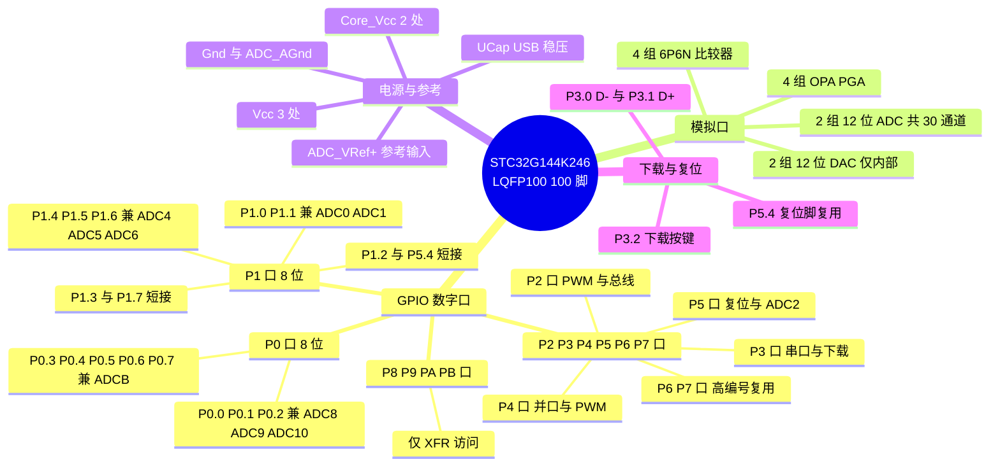

# STC32G144K246 引脚配置与使能 · 超级详细指南（LQFP100）

> **数据来源**：STC 官方《STC32G144K246 系列技术手册》（1242 页 PDF，2026-11 版；本文页码均为 PDF 物理页）——§3.1.7 管脚说明 p153-174、§12 I/O 口 p384-408、§6 时钟 p240-253、§8 复位与电源 p257-271、§13 中断 p409-481、§20 ADC p708-730、§21 DAC p731-735、§22 OPA/PGA p736-768、§18 比较器 p680-699。
>
> **适用芯片**：STC32G144K246（LQFP100，32 位 80251 内核，246KB Flash，16K edata + 128K xdata + 4K 可执行 RAM，最高 120MHz）。同族 STC32G96K246 / STC32G18K64 引脚基本兼容，以本表 LQFP100 列为准。
>
> **本工程上下文**：`projects/stc32/stc32g144k246-blink` 使用 **P0.0 作 LED（低电平点亮）**、**P4.1 作 LED 电源使能（低有效）**，P0 整口强推挽输出。所有引脚宏集中在 `Config/stc32g144k246_conf.h`，改接线只改宏，不改 `main.c`。

---

## 目录

- [1. 芯片与封装总览](#1-芯片与封装总览)
- [2. LQFP100 最小系统](#2-lqfp100-最小系统)
- [3. 全部 100 个物理引脚逐脚详解](#3-全部-100-个物理引脚逐脚详解)
- [4. 复用功能索引（按外设分类）](#4-复用功能索引按外设分类)
- [5. GPIO 配置机制](#5-gpio-配置机制)
- [6. 时钟、复位与 i-Cache](#6-时钟复位与-i-cache)
- [7. 中断系统与向量表](#7-中断系统与向量表)
- [8. 下载与调试接线](#8-下载与调试接线)
- [9. 本工程使用的引脚](#9-本工程使用的引脚)
- [10. 常见坑 FAQ](#10-常见坑-faq)

---

## 1. 芯片与封装总览

| 项目 | 参数 | 出处 |
|---|---|---|
| 内核 | Intel MCS-251（80251）32 位，兼容 1T 8051 | p141 |
| 最高主频 | 120MHz（WTST=4）；TFPU/PWM/SPI/I2S 可用 230MHz PLL 时钟 | p142/p288 |
| 工作电压 | 1.9V ~ 5.5V；Core_Vcc 由内部 1.5V LDO 产生 | p141/p144 |
| 温度范围 | −40℃ ~ +125℃ | p141 |
| Flash | 246KB，10 万次擦写 | p141/p287 |
| SRAM | 16K edata + 128K xdata + 4K 可执行 RAM | p141/p289 |
| GPIO | 最多 91 个（P0~P9、PA、PB） | p143 |
| 封装 | LQFP100 16×16mm（本指南主表）；另有 LQFP64/48/44、QFN100/64/48 | p218-235 |
| ADC | 2 组 12 位，15+15 通道 | p708 |
| DAC | 2 组 12 位，2MHz，无输出缓冲 | p731 |
| 运放 | 4 组 RRIO OPA/PGA | p736 |
| 比较器 | 4 组 6P6N | p680 |
| 定时器 | 14 个 24 位（T0~T11、T17、T18） | p488 |
| 串口 | 8 组 USART（同步/异步/SPI/LIN/IrDA/ISO7816） | p546 |
| 其它 | 3×SPI + QSPI + 2×I2C + 2×CAN-FD + 2×LIN + USB FS + 2×I2S + TFT 接口 + DMA | p769 起 |

### 1.1 LQFP100 引脚分类一图流



### 1.2 电源、地、参考引脚清单

| LQFP100 | LQFP64 | LQFP48 | LQFP44 | 名称 | 类型 | 说明 |
|---|---|---|---|---|---|---|
| 17 | 8 | 5 | 4 | **Core_Vcc** | VCC | 内核电源脚 |
| 25 | 16 | 12 | 11 | **ADC_AGnd** | GND | ADC 地线 |
| 26 | 17 | 13 | 12 | **UCap** | I | USB 内核电源稳压脚 |
| 28 | 19 | 15 | 14 | **Vcc** | VCC | 电源脚 |
| 29 | 20 | 16 | 15 | **ADC_VRef+** | I | ADC 的参考电压脚 |
| 30 | 21 | 17 | 16 | **Gnd** | GND | 地线 |
| 44 | — | — | — | **Vcc** | VCC | 电源脚 |
| 67 | 41 | 29 | 26 | **Vcc** | VCC | 电源脚 |
| 92 | — | — | — | **Core_Vcc** | VCC | 内核电源脚 |

> **最小系统要点**（p144）：
> 1. `Core_Vcc` 外接 **10µF ~ 22µF** 电容到地，内部 1.5V LDO 不能外接负载；
> 2. `ADC_AVcc`/`ADC_VRef+` 接 ADC 参考源或直接接 MCU-Vcc，`ADC_AGnd` 接模拟地；
> 3. 模拟地与数字地最后在系统地处 **单点短接**；
> 4. 芯片内置专业复位电路，**不需要**传统 8051 的阻容上电延时电路。

### 1.3 与 STM32 的根本差异（别套 STM32 的思维）

| 差异点 | STM32（F1/F4/H7） | **STC32G144K246** |
|---|---|---|
| GPIO 模式寄存器 | MODER/OTYPER/OSPEEDR/PUPDR 四件套（F4）或 CRL/CRH（F1） | **PnM1:PnM0 两位** 决定准双向/推挽/高阻/开漏（p395） |
| 外设复用 | 每个脚有 AF0~AF15，写 AFR 选择 | **没有 AF 编号**，靠 `P_SW1~P_SWX` 寄存器把功能切到不同脚组；同一功能可有多组 `_2/_3/_4` 引脚 |
| 输出驱动 | 一般几 mA ~ 20mA | 准双向/推挽**灌/拉电流可达 20mA**，但整芯片流入/流出建议 ≤90mA（p395） |
| 上电默认 | 多数为输入/模拟 | **所有 I/O 上电为高阻输入**，不配置模式就“不工作”（p143） |
| 中断优先级 | NVIC 4 位抢占 + 子优先级 | **4 级优先级**（0 最低 ~ 3 最高），同优先级按查询次序（p409/p414） |
| 烧录/调试 | SWD/JTAG | **UART/USB ISP**，官方工具 Windows-only；OpenOCD 不支持 STC（见 README） |

---

## 2. LQFP100 最小系统

| 项目 | 接法/参数 | 说明 |
|---|---|---|
| 主电源 | Vcc（pin 28/44/67）接 1.9~5.5V | 每组 Vcc 就近放 0.1µF + 10µF |
| 内核电源 | Core_Vcc（pin 17/92）接 10~22µF 到地 | 内部 1.5V LDO 输出，**不可外接负载** |
| 地 | Gnd（pin 30）+ ADC_AGnd（pin 25） | 模拟地/数字地单点汇接 |
| ADC 参考 | ADC_VRef+（pin 29）接参考源或 Vcc | 不用 ADC 时可接 Vcc |
| USB 稳压 | UCap（pin 26）接 0.1µF 到地 | USB 内核稳压脚，**不可省** |
| 复位 | P5.4 默认 I/O；ISP 下载时可设为复位脚 | 设为复位脚后**低电平复位** |
| 下载 | P3.0=D−、P3.1=D+（各串 22Ω） | 按住 P3.2 上电进入 USB 等待下载模式 |
| 晶振 | 可省 | 内部 HIRC ±0.3%@25℃；需要高精度时外接 4~40MHz |

> 注意：LQFP100 的 **P1.2 与 P5.4 在封装内短接**（都打到 pin 27），**P1.3 与 P1.7 短接**（都打到 pin 24）（p144）。布板时这两个“脚对”只能当一个用；P5.4 设为复位脚后，P1.2 的数字功能仍可切换，但 ADC2 的模拟功能不能切到 P1.2。

---

## 3. 全部 100 个物理引脚逐脚详解

> 本机芯片为 **LQFP100**，所以主表按 LQFP100 的 1~100 脚排列；64/48/44 列给出同功能引脚号，`—` 表示该封装无此脚。
> 封装定位：正看芯片丝印，**左下方小圆点为第 1 脚**，逆时针编号 1→100（规格书 p144）。
> 下节先给 100 脚速查表（只列主功能），再按端口分组列出每脚的复用功能信号名；完整信号说明见第 4 节。

### 3.1 LQFP100 100 脚速查表

| LQFP100 | LQFP64 | LQFP48 | LQFP44 | 名称 | 类型 | 主功能 |
|---:|---:|---:|---:|---|---|---|
| 1 | 1 | 1 | 1 | **P5.3** | I/O | 标准I/O 口 |
| 2 | 2 | 2 | 1 | **P0.5** | I/O | 标准I/O 口 |
| 3 | 3 | 3 | 2 | **P0.6** | I/O | 标准I/O 口 |
| 4 | 4 | 4 | 3 | **P0.7** | I/O | 标准I/O 口 |
| 5 | 5 | — | — | **P6.0** | I/O | 标准I/O 口 |
| 6 | 6 | — | — | **P6.1** | I/O | 标准I/O 口 |
| 7 | 7 | — | — | **P6.2** | I/O | 标准I/O 口 |
| 8 | — | — | — | **P6.3** | I/O | 标准I/O 口 |
| 9 | — | — | — | **P8.0** | I/O | 标准I/O 口 |
| 10 | — | — | — | **P8.1** | I/O | 标准I/O 口 |
| 11 | — | — | — | **P8.2** | I/O | 标准I/O 口 |
| 12 | — | — | — | **P8.3** | I/O | 标准I/O 口 |
| 13 | — | — | — | **P8.4** | I/O | 标准I/O 口 |
| 14 | — | — | — | **P8.5** | I/O | 标准I/O 口 |
| 15 | — | — | — | **P8.6** | I/O | 标准I/O 口 |
| 16 | — | — | — | **P8.7** | I/O | 标准I/O 口 |
| 17 | 8 | 5 | 4 | **Core_Vcc** | VCC | 内核电源脚 |
| 18 | 9 | — | — | **P1.0** | I/O | 标准I/O 口 |
| 19 | 10 | 6 | 5 | **P1.1** | I/O | 标准I/O 口 |
| 20 | 11 | 7 | 6 | **P4.7** | I/O | 标准I/O 口 |
| 21 | 12 | 8 | 7 | **P1.4** | I/O | 标准I/O 口 |
| 22 | 13 | 9 | 8 | **P1.5** | I/O | 标准I/O 口 |
| 23 | 14 | 10 | 9 | **P1.6** | I/O | 标准I/O 口 |
| 24 | 15 | 11 | 10 | **P1.7** | I/O | 标准I/O 口 |
| 25 | 16 | 12 | 11 | **ADC_AGnd** | GND | ADC 地线 |
| 26 | 17 | 13 | 12 | **UCap** | I | USB 内核电源稳压脚 |
| 27 | 18 | 14 | 13 | **P5.4** | I/O | 标准I/O 口 |
| 28 | 19 | 15 | 14 | **Vcc** | VCC | 电源脚 |
| 29 | 20 | 16 | 15 | **ADC_VRef+** | I | ADC 的参考电压脚 |
| 30 | 21 | 17 | 16 | **Gnd** | GND | 地线 |
| 31 | 22 | 18 | 17 | **P4.0** | I/O | 标准I/O 口 |
| 32 | 23 | — | — | **P6.4** | I/O | 标准I/O 口 |
| 33 | 24 | — | — | **P6.5** | I/O | 标准I/O 口 |
| 34 | 25 | — | — | **P6.6** | I/O | 标准I/O 口 |
| 35 | 26 | — | — | **P6.7** | I/O | 标准I/O 口 |
| 36 | — | — | — | **P9.0** | I/O | 标准I/O 口 |
| 37 | — | — | — | **P9.1** | I/O | 标准I/O 口 |
| 38 | — | — | — | **P9.2** | I/O | 标准I/O 口 |
| 39 | — | — | — | **P9.3** | I/O | 标准I/O 口 |
| 40 | — | — | — | **P9.4** | I/O | 标准I/O 口 |
| 41 | — | — | — | **P9.5** | I/O | 标准I/O 口 |
| 42 | — | — | — | **P9.6** | I/O | 标准I/O 口 |
| 43 | — | — | — | **P9.7** | I/O | 标准I/O 口 |
| 44 | — | — | — | **Vcc** | VCC | 电源脚 |
| 45 | 27 | 19 | 18 | **P3.0** | I/O | 标准I/O 口 |
| 46 | 28 | 20 | 19 | **P3.1** | I/O | 标准I/O 口 |
| 47 | 29 | 21 | 20 | **P3.2** | I/O | 标准I/O 口 |
| 48 | 30 | 22 | 21 | **P3.3** | I/O | 标准I/O 口 |
| 49 | 31 | 23 | 22 | **P3.4** | I/O | 标准I/O 口 |
| 50 | 32 | 24 | 22 | **P5.0** | I/O | 标准I/O 口 |
| 51 | 33 | 25 | 23 | **P5.1** | I/O | 标准I/O 口 |
| 52 | 34 | 26 | 23 | **P3.5** | I/O | 标准I/O 口 |
| 53 | 35 | 27 | 24 | **P3.6** | I/O | 标准I/O 口 |
| 54 | 36 | 28 | 25 | **P3.7** | I/O | 标准I/O 口 |
| 55 | 37 | — | — | **P7.0** | I/O | 标准I/O 口 |
| 56 | 38 | — | — | **P7.1** | I/O | 标准I/O 口 |
| 57 | 39 | — | — | **P7.2** | I/O | 标准I/O 口 |
| 58 | 40 | — | — | **P7.3** | I/O | 标准I/O 口 |
| 59 | — | — | — | **PA.0** | I/O | 标准I/O 口 |
| 60 | — | — | — | **PA.1** | I/O | 标准I/O 口 |
| 61 | — | — | — | **PA.2** | I/O | 标准I/O 口 |
| 62 | — | — | — | **PA.3** | I/O | 标准I/O 口 |
| 63 | — | — | — | **PA.4** | I/O | 标准I/O 口 |
| 64 | — | — | — | **PA.5** | I/O | 标准I/O 口 |
| 65 | — | — | — | **PA.6** | I/O | 标准I/O 口 |
| 66 | — | — | — | **PA.7** | I/O | 标准I/O 口 |
| 67 | 41 | 29 | 26 | **Vcc** | VCC | 电源脚 |
| 68 | — | — | — | **P4.1** | I/O | 标准I/O 口 |
| 69 | 42 | 30 | 27 | **P4.2** | I/O | 标准I/O 口 |
| 70 | 43 | 31 | 28 | **P4.3** | I/O | 标准I/O 口 |
| 71 | 44 | 32 | 29 | **P4.4** | I/O | 标准I/O 口 |
| 72 | 45 | 33 | 30 | **P2.0** | I/O | 标准I/O 口 |
| 73 | 46 | 34 | 31 | **P2.1** | I/O | 标准I/O 口 |
| 74 | 47 | 35 | 32 | **P2.2** | I/O | 标准I/O 口 |
| 75 | 48 | 36 | 33 | **P2.3** | I/O | 标准I/O 口 |
| 76 | 49 | 37 | 34 | **P2.4** | I/O | 标准I/O 口 |
| 77 | 50 | 38 | 35 | **P2.5** | I/O | 标准I/O 口 |
| 78 | 51 | 39 | 36 | **P2.6** | I/O | 标准I/O 口 |
| 79 | 52 | 40 | 37 | **P2.7** | I/O | 标准I/O 口 |
| 80 | 53 | — | — | **P7.4** | I/O | 标准I/O 口 |
| 81 | 54 | — | — | **P7.5** | I/O | 标准I/O 口 |
| 82 | 55 | — | — | **P7.6** | I/O | 标准I/O 口 |
| 83 | 56 | — | — | **P7.7** | I/O | 标准I/O 口 |
| 84 | — | — | — | **PB.0** | I/O | 标准I/O 口 |
| 85 | — | — | — | **PB.1** | I/O | 标准I/O 口 |
| 86 | — | — | — | **PB.2** | I/O | 标准I/O 口 |
| 87 | — | — | — | **PB.3** | I/O | 标准I/O 口 |
| 88 | — | — | — | **PB.4** | I/O | 标准I/O 口 |
| 89 | — | — | — | **PB.5** | I/O | 标准I/O 口 |
| 90 | — | — | — | **PB.6** | I/O | 标准I/O 口 |
| 91 | — | — | — | **PB.7** | I/O | 标准I/O 口 |
| 92 | — | — | — | **Core_Vcc** | VCC | 内核电源脚 |
| 93 | 57 | 41 | 38 | **P4.5** | I/O | 标准I/O 口 |
| 94 | 58 | 42 | 39 | **P4.6** | I/O | 标准I/O 口 |
| 95 | 59 | 43 | 40 | **P0.0** | I/O | 标准I/O 口 |
| 96 | 60 | 44 | 41 | **P0.1** | I/O | 标准I/O 口 |
| 97 | 61 | 45 | 42 | **P0.2** | I/O | 标准I/O 口 |
| 98 | 62 | 46 | 43 | **P0.3** | I/O | 标准I/O 口 |
| 99 | 63 | 47 | 44 | **P0.4** | I/O | 标准I/O 口 |
| 100 | 64 | 48 | 44 | **P5.2** | I/O | 标准I/O 口 |

### 3.2 按端口分组的复用功能

> 每行格式：**引脚名**（LQFP100 脚号；LQFP64/48/44 脚号）：复用信号名。`_2/_3/_4` 是同一功能的第 2/3/4 组可选引脚。

#### P0 口（8 脚）

- **P0.0**（LQFP100 pin 95；64/48/44 = 59/43/40）：`AD0`、`ADC8`、`ADCB0`、`T3_2`、`RXD3`、`PWMB5_3`、`PWMFETI_3`、`OPA1O_2`、`OPA2O_2`、`CAN_RX`
- **P0.1**（LQFP100 pin 96；64/48/44 = 60/44/41）：`AD1`、`ADC9`、`ADCB1`、`T3CLKO_2`、`TXD3`、`PWMB6_3`、`PWMFFLT_3`、`CAN_TX`
- **P0.2**（LQFP100 pin 97；64/48/44 = 61/45/42）：`AD2`、`ADC10`、`ADCB2`、`T4_2`、`RXD4`、`S3SS_2`、`S4SS_2`、`SS2_2`、`PWMB7_3`、`PWMEETI_2`、`LIN_RX`、`CAN2_RX`
- **P0.3**（LQFP100 pin 98；64/48/44 = 62/46/43）：`AD3`、`ADCB3`、`T4CLKO_2`、`TXD4`、`S3MOSI_2`、`S4MOSI_2`、`MOSI2_2`、`PWMB8_3`、`PWMEFLT_2`、`LIN_TX`、`CAN2_TX`
- **P0.4**（LQFP100 pin 99；64/48/44 = 63/47/44）：`AD4`、`ADCB4`、`T3`、`S3MISO_2`、`S4MISO_2`、`RxD5`、`MISO2_2`、`PWMA5_2`、`OPA1+`、`OPA1-_2`
- **P0.5**（LQFP100 pin 2；64/48/44 = 2/2/1）：`AD5`、`ADCB5`、`T3CLKO`、`S3SCLK_2`、`S4SCLK_2`、`TxD5`、`SCLK2_2`、`PWMA6_2`、`OPA1+_2`、`OPA1-`
- **P0.6**（LQFP100 pin 3；64/48/44 = 3/3/2）：`AD6`、`ADCB6`、`T4`、`RxD6`、`PWMBETI_2`、`LIN2_RX`、`CAN_STB`
- **P0.7**（LQFP100 pin 4；64/48/44 = 4/4/3）：`AD7`、`ADCB7`、`T4CLKO`、`TxD6`、`PWMBFLT_2`、`OPA1O`、`LIN2_TX`、`CAN2_STB`、`CAN2_STB_5`

#### P1 口（6 脚）

- **P1.0**（LQFP100 pin 18；64/48/44 = 9/—/—）：`ADC0`、`RXD2`、`PWMA1P`、`CMP2+_2`、`CAN2_RX_5`、`QSPI_IO3`
- **P1.1**（LQFP100 pin 19；64/48/44 = 10/6/5）：`ADC1`、`TXD2`、`PWMA1N`、`PWMC5`、`CMP2-_2`、`CAN2_TX_5`、`QSPI_IO2`
- **P1.4**（LQFP100 pin 21；64/48/44 = 12/8/7）：`ADC4`、`T11_2`、`S1MISO`、`S2MISO`、`RxD5_3`、`MISO`、`I2CSDA`、`PWMA3P`、`CAN_RX_7`、`QSPI_IO1`
- **P1.5**（LQFP100 pin 22；64/48/44 = 13/9/8）：`ADC5`、`T11CKO_2`、`S1SCLK`、`S2SCLK`、`TxD5_3`、`SCLK`、`I2CSCL`、`PWMA3N`、`PWMA6_4`、`CAN_TX_7`、`QSPI_CLK`
- **P1.6**（LQFP100 pin 23；64/48/44 = 14/10/9）：`ADC6`、`RXD_3`、`XTALO`、`MCLKO_2`、`I2CSDA2_3`、`PWMA4P`、`OPA4+`、`I2S_MCK_4`
- **P1.7**（LQFP100 pin 24；64/48/44 = 15/11/10）：`ADC7`、`TXD_3`、`XTALI`、`I2CSCL2_3`、`PWMA4N`、`PWMB5_2`、`PWMC6`、`OPA4-`、`ADC3`、`T2CLKO`、`S1MOSI`、`S2MOSI`、`TxD7_4`、`MOSI`、`PWMA2N`、`PWMA5_4`、`OPA4O`、`QSPI_IO0`

#### P2 口（8 脚）

- **P2.0**（LQFP100 pin 72；64/48/44 = 45/33/30）：`A8`、`T5`、`RxD5_4`、`PWMA1P_2`、`PWMB5`、`OPA3+_2`
- **P2.1**（LQFP100 pin 73；64/48/44 = 46/34/31）：`A9`、`T5CLKO`、`TxD5_4`、`PWMA1N_2`、`PWMB6`、`OPA3O_2`
- **P2.2**（LQFP100 pin 74；64/48/44 = 47/35/32）：`A10`、`T6`、`S1SS_2`、`S2SS_2`、`S5SS`、`S6SS`、`SS_2`、`SS3`、`PWMA2P_2`、`PWMB7`、`CAN_STB_2`、`I2S_LRCK_3`
- **P2.3**（LQFP100 pin 75；64/48/44 = 48/36/33）：`A11`、`T6CLKO`、`S1MOSI_2`、`S2MOSI_2`、`S5MOSI`、`S6MOSI`、`MOSI_2`、`MOSI3`、`PWMA2N_2`、`PWMB8`、`CAN2_STB_2`、`CAN2_STB_7`、`I2S_Data_3`
- **P2.4**（LQFP100 pin 76；64/48/44 = 49/37/34）：`A12`、`T7`、`S1MISO_2`、`S2MISO_2`、`S5MISO`、`S6MISO`、`MISO_2`、`MISO3`、`I2CSDA_2`、`PWMA3P_2`、`PWMD5`、`CMP3O`、`I2S_MCK_3`
- **P2.5**（LQFP100 pin 77；64/48/44 = 50/38/35）：`A13`、`T7CLKO`、`S1SCLK_2`、`S2SCLK_2`、`S5SCLK`、`S6SCLK`、`SCLK_2`、`SCLK3`、`I2CSCL_2`、`PWMA3N_2`、`PWMD6`、`CMP4O`、`I2S_BCK_3`
- **P2.6**（LQFP100 pin 78；64/48/44 = 51/39/36）：`A14`、`T8`、`RxD6_4`、`I2CSDA2`、`PWMA4P_2`、`PWMD7`、`CMP4-`、`OPA2+`、`LIN2_RX_2`
- **P2.7**（LQFP100 pin 79；64/48/44 = 52/40/37）：`A15`、`T8CLKO`、`TxD6_4`、`I2CSCL2`、`PWMA4N_2`、`PWMD8`、`CMP4+`、`OPA2-`、`LIN2_TX_2`

#### P3 口（8 脚）

- **P3.0**（LQFP100 pin 45；64/48/44 = 27/19/18）：`RXD`、`INT4`、`CAN_RX_5`、`D-`
- **P3.1**（LQFP100 pin 46；64/48/44 = 28/20/19）：`TXD`、`CAN_TX_5`、`D+`
- **P3.2**（LQFP100 pin 47；64/48/44 = 29/21/20）：`RxD6_3`、`INT0`、`SCLK_4`、`I2CSCL_4`、`PWMAETI`、`PWMBETI`、`PWMCETI`、`PWMDETI`、`PWMEETI`、`PWMFETI`、`OPA3O`、`I2S_BCK`
- **P3.3**（LQFP100 pin 48；64/48/44 = 30/22/21）：`TxD6_3`、`INT1`、`MISO_4`、`I2CSDA_4`、`PWMA4N_4`、`PWMB7_2`、`OPA4-_3`、`CAN_STB_5`、`CAN_STB_7`、`I2S_MCK`
- **P3.4**（LQFP100 pin 49；64/48/44 = 31/23/22）：`T0`、`T1CLKO`、`MOSI_4`、`PWMA4P_4`、`PWMB8_2`、`CMP1O`、`I2S_Data`
- **P3.5**（LQFP100 pin 52；64/48/44 = 34/26/23）：`T1`、`T0CLKO`、`SS_4`、`PWMAFLT`、`PWMBFLT`、`PWMCFLT`、`PWMDFLT`、`PWMEFLT`、`PWMFFLT`、`OPA3+`、`I2S_LRCK`
- **P3.6**（LQFP100 pin 53；64/48/44 = 35/27/24）：`RXD_2`、`INT2`、`I2CSDA2_2`、`PWMC5_2`、`CMP1-`、`CAN_RX_6`
- **P3.7**（LQFP100 pin 54；64/48/44 = 36/28/25）：`TXD_2`、`INT3`、`I2CSCL2_2`、`PWMC6_2`、`CMP1+`、`CAN_TX_6`

#### P4 口（8 脚）

- **P4.0**（LQFP100 pin 31；64/48/44 = 22/18/17）：`S1MOSI_3`、`S2MOSI_3`、`RxD5_2`、`MOSI_3`、`PWMC1P_3`、`CMP2O_2`、`OPA4O_2`、`QSPI_IO0_2`、`I2S_Data_4`
- **P4.1**（LQFP100 pin 68；64/48/44 = —/—/—）：`S1MISO_3`、`S2MISO_3`、`TxD5_2`、`MISO_3`、`PWMAETI_2`、`PWMC1N_3`、`CMP1O_2`、`QSPI_IO1_2`、`I2S_LRCK_4`
- **P4.2**（LQFP100 pin 69；64/48/44 = 42/30/27）：`WR`、`PWMC2P_3`、`OPA2O`、`OPA3-_2`、`CAN_RX_3`
- **P4.3**（LQFP100 pin 70；64/48/44 = 43/31/28）：`ADC_ETR_2`、`ADCB_ETR_2`、`RXD_4`、`S1SCLK_3`、`S2SCLK_3`、`SCLK_3`、`PWMC2N_3`、`PWME5_2`、`CMP4+_2`、`CAN_RX_8`、`QSPI_CLK_2`、`I2S_BCK_4`
- **P4.4**（LQFP100 pin 71；64/48/44 = 44/32/29）：`RD`、`T11_4`、`TXD_4`、`PWMC3P_3`、`PWME6_2`、`CMP4-_2`、`CAN_TX_8`
- **P4.5**（LQFP100 pin 93；64/48/44 = 57/41/38）：`ALE`、`T11CKO_4`、`PWMAFLT_2`、`PWMC3N_3`、`CMP3O_2`、`CAN_TX_3`、`CAN_STB_4`
- **P4.6**（LQFP100 pin 94；64/48/44 = 58/42/39）：`RXD2_2`、`PWMA5`、`PWMC4P_3`、`CMP4O_2`、`LIN_RX_3`、`CAN2_RX_3`、`QSPI_IO2_2`
- **P4.7**（LQFP100 pin 20；64/48/44 = 11/7/6）：`TXD2_2`、`PWMA6`、`PWMC4N_3`、`CMP2O`、`LIN_TX_3`、`CAN2_TX_3`、`CAN2_STB_4`、`QSPI_IO3_2`

#### P5 口（5 脚）

- **P5.0**（LQFP100 pin 50；64/48/44 = 32/24/22）：`RXD3_2`、`RxD7`、`S7SS`、`S8SS`、`PWMD5_3`、`PWME5`、`CMP1+_2`、`OPA3O_4`、`CAN_RX_2`、`I2S2_LRCK`
- **P5.1**（LQFP100 pin 51；64/48/44 = 33/25/23）：`TXD3_2`、`TxD7`、`S7MOSI`、`S8MOSI`、`PWMD6_3`、`PWME6`、`CMP1-_2`、`OPA3-`、`CAN_TX_2`、`CAN_STB_3`、`I2S2_Data`
- **P5.2**（LQFP100 pin 100；64/48/44 = 64/48/44）：`RXD4_2`、`RxD8`、`S7MISO`、`S8MISO`、`PWMD7_3`、`CMP3-_2`、`LIN_RX_2`、`CAN2_RX_2`、`I2S2_MCK`
- **P5.3**（LQFP100 pin 1；64/48/44 = 1/1/1）：`TXD4_2`、`TxD8`、`S7SCLK`、`S8SCLK`、`PWMD8_3`、`CMP3+_2`、`LIN_TX_2`、`CAN2_TX_2`、`CAN2_STB_3`、`I2S2_BCK`
- **P5.4**（LQFP100 pin 27；64/48/44 = 18/14/13）：`S1SS_3`、`S2SS_3`、`RST`、`MCLKO`、`SS_3`、`PWMB6_2`、`QSPI_NCS_2`、`ADC2`、`ADC_ETR`、`ADCB_ETR`、`T2`、`S1SS`、`S2SS`、`RxD7_4`、`SS`、`PWMA2P`、`CAN_STB_6`、`QSPI_NCS`

#### P6 口（8 脚）

- **P6.0**（LQFP100 pin 5；64/48/44 = 5/—/—）：`ADCB8`、`T10`、`RxD8_4`、`S8SS_4`、`I2CSDA2_4`、`PWMA1P_3`、`PWMC1P`、`OPA1+_3`、`I2S2_LRCK_2`
- **P6.1**（LQFP100 pin 6；64/48/44 = 6/—/—）：`ADCB9`、`T10CLKO`、`TxD8_4`、`S8MOSI_4`、`I2CSCL2_4`、`PWMA1N_3`、`PWMC1N`、`OPA1-_3`、`I2S2_Data_2`
- **P6.2**（LQFP100 pin 7；64/48/44 = 7/—/—）：`ADCB10`、`RxD6_2`、`S8MISO_4`、`PWMA2P_3`、`PWMC2P`、`OPA2O_4`、`LIN2_RX_3`、`I2S2_MCK_2`
- **P6.3**（LQFP100 pin 8；64/48/44 = —/—/—）：`TxD6_2`、`S8SCLK_4`、`PWMA2N_3`、`PWMC2N`、`PWMC5_4`、`OPA1O_4`、`OPA4+_2`、`OPA4O_4`、`LIN2_TX_3`、`I2S2_BCK_2`
- **P6.4**（LQFP100 pin 32；64/48/44 = 23/—/—）：`S1SS_4`、`S3SS`、`S4SS`、`SS2`、`PWMA3P_3`、`PWMC3P`、`OPA4+_3`、`I2S_Data_2`
- **P6.5**（LQFP100 pin 33；64/48/44 = 24/—/—）：`S1MOSI_4`、`S3MOSI`、`S4MOSI`、`MOSI2`、`PWMA3N_3`、`PWMC3N`、`PWMC6_4`、`OPA4-_2`、`I2S_LRCK_2`
- **P6.6**（LQFP100 pin 34；64/48/44 = 25/—/—）：`S1MISO_4`、`S3MISO`、`S4MISO`、`MISO2`、`PWMA4P_3`、`PWMC4P`、`CMP2-`、`I2S_BCK_2`
- **P6.7**（LQFP100 pin 35；64/48/44 = 26/—/—）：`S1SCLK_4`、`S3SCLK`、`S4SCLK`、`SCLK2`、`PWMA4N_3`、`PWMC4N`、`CMP2+`、`I2S_MCK_2`

#### P7 口（8 脚）

- **P7.0**（LQFP100 pin 55；64/48/44 = 37/—/—）：`T9`、`S4SS_4`、`S5SS_2`、`S6SS_2`、`SS3_2`、`PWMCETI_2`、`PWMDETI_2`、`PWME1P`、`PWMF5`、`OPA3+_3`、`CAN_RX_4`、`QSPI_IO0_3`
- **P7.1**（LQFP100 pin 56；64/48/44 = 38/—/—）：`T9CLKO`、`S4MOSI_4`、`S5MOSI_2`、`S6MOSI_2`、`MOSI3_2`、`PWMCFLT_2`、`PWMDFLT_2`、`PWME1N`、`PWMF6`、`OPA3-_3`、`CAN_TX_4`、`QSPI_CLK_3`
- **P7.2**（LQFP100 pin 57；64/48/44 = 39/—/—）：`S4MISO_4`、`S5MISO_2`、`S6MISO_2`、`MISO3_2`、`PWMA5_3`、`PWME2P`、`PWMF7`、`LIN_RX_4`、`CAN2_RX_4`、`QSPI_IO1_3`
- **P7.3**（LQFP100 pin 58；64/48/44 = 40/—/—）：`S4SCLK_4`、`S5SCLK_2`、`S6SCLK_2`、`SCLK3_2`、`PWMAETI_3`、`PWMA6_3`、`PWME2N`、`PWMF8`、`LIN_TX_4`、`CAN2_TX_4`、`QSPI_IO2_3`
- **P7.4**（LQFP100 pin 80；64/48/44 = 53/—/—）：`S2SS_4`、`S7SS_3`、`S8SS_3`、`PWMB5_4`、`PWME3P`、`OPA1O_3`、`OPA2O_3`、`OPA3O_3`、`OPA4O_3`、`CAN_STB_8`、`QSPI_IO3_3`
- **P7.5**（LQFP100 pin 81；64/48/44 = 54/—/—）：`S2MOSI_4`、`S7MOSI_3`、`S8MOSI_3`、`PWMB6_4`、`PWME3N`、`OPA2+_3`、`QSPI_NCS_3`
- **P7.6**（LQFP100 pin 82；64/48/44 = 55/—/—）：`T11`、`S2MISO_4`、`S7MISO_3`、`S8MISO_3`、`I2CSDA_3`、`PWMB7_4`、`PWME4P`、`CMP3-`、`OPA2-_3`
- **P7.7**（LQFP100 pin 83；64/48/44 = 56/—/—）：`T11CKO`、`S2SCLK_4`、`S7SCLK_3`、`S8SCLK_3`、`I2CSCL_3`、`PWMB8_4`、`PWME4N`、`CMP3+`、`OPA2+_4`

#### P8 口（8 脚）

- **P8.0**（LQFP100 pin 9；64/48/44 = —/—/—）：`T17`、`SS2_4`、`PWMC1P_2`、`OPA2+_2`、`I2S2_LRCK_3`
- **P8.1**（LQFP100 pin 10；64/48/44 = —/—/—）：`T17CLKO`、`MOSI2_4`、`PWMC1N_2`、`PWMD5_2`、`OPA2-_2`、`I2S2_Data_3`
- **P8.2**（LQFP100 pin 11；64/48/44 = —/—/—）：`MISO2_4`、`PWMC2P_2`、`I2S2_MCK_3`
- **P8.3**（LQFP100 pin 12；64/48/44 = —/—/—）：`SCLK2_4`、`PWMC2N_2`、`PWMD6_2`、`CAN2_STB_6`、`I2S2_BCK_3`
- **P8.4**（LQFP100 pin 13；64/48/44 = —/—/—）：`RXD2_3`、`S5SS_3`、`S6SS_3`、`SS3_3`、`PWMC3P_2`、`LIN2_RX_4`、`CAN2_RX_6`
- **P8.5**（LQFP100 pin 14；64/48/44 = —/—/—）：`TXD2_3`、`S5MOSI_3`、`S6MOSI_3`、`MOSI3_3`、`PWMC3N_2`、`PWMD7_2`、`LIN2_TX_4`、`CAN2_TX_6`
- **P8.6**（LQFP100 pin 15；64/48/44 = —/—/—）：`RXD3_3`、`S5MISO_3`、`S6MISO_3`、`MISO3_3`、`PWMC4P_2`
- **P8.7**（LQFP100 pin 16；64/48/44 = —/—/—）：`TXD3_3`、`S5SCLK_3`、`S6SCLK_3`、`SCLK3_3`、`PWMC4N_2`、`PWMD8_2`

#### P9 口（8 脚）

- **P9.0**（LQFP100 pin 36；64/48/44 = —/—/—）：`T18`、`RxD7_3`、`S5SS_4`、`SS3_4`、`PWME1P_2`、`PWMF5_3`
- **P9.1**（LQFP100 pin 37；64/48/44 = —/—/—）：`T18CLKO`、`TxD7_3`、`S5MOSI_4`、`MOSI3_4`、`PWME1N_2`、`PWMF6_3`
- **P9.2**（LQFP100 pin 38；64/48/44 = —/—/—）：`RxD8_3`、`S5MISO_4`、`MISO3_4`、`PWME2P_2`、`PWMF7_3`
- **P9.3**（LQFP100 pin 39；64/48/44 = —/—/—）：`TxD8_3`、`S5SCLK_4`、`SCLK3_4`、`PWME2N_2`、`PWMF8_3`
- **P9.4**（LQFP100 pin 40；64/48/44 = —/—/—）：`S3SS_4`、`S6SS_4`、`PWMCETI_3`、`PWME3P_2`
- **P9.5**（LQFP100 pin 41；64/48/44 = —/—/—）：`S3MOSI_4`、`S6MOSI_4`、`PWMCFLT_3`、`PWME3N_2`、`PWME5_4`
- **P9.6**（LQFP100 pin 42；64/48/44 = —/—/—）：`S3MISO_4`、`S6MISO_4`、`PWMC5_3`、`PWME4P_2`
- **P9.7**（LQFP100 pin 43；64/48/44 = —/—/—）：`S3SCLK_4`、`S6SCLK_4`、`PWMC6_3`、`PWME4N_2`、`PWME6_4`

#### PA 口（8 脚）

- **PA.0**（LQFP100 pin 59；64/48/44 = —/—/—）：`RXD2_4`、`PWME1P_3`、`CAN2_RX_7`
- **PA.1**（LQFP100 pin 60；64/48/44 = —/—/—）：`TXD2_4`、`PWME1N_3`、`PWMF5_2`、`CAN2_TX_7`
- **PA.2**（LQFP100 pin 61；64/48/44 = —/—/—）：`RXD4_3`、`PWME2P_3`
- **PA.3**（LQFP100 pin 62；64/48/44 = —/—/—）：`TXD4_3`、`PWME2N_3`、`PWMF6_2`
- **PA.4**（LQFP100 pin 63；64/48/44 = —/—/—）：`RxD7_2`、`S7SS_2`、`S8SS_2`、`PWME3P_3`
- **PA.5**（LQFP100 pin 64；64/48/44 = —/—/—）：`TxD7_2`、`S7MOSI_2`、`S8MOSI_2`、`PWME3N_3`、`PWMF7_2`
- **PA.6**（LQFP100 pin 65；64/48/44 = —/—/—）：`T11_3`、`RxD8_2`、`S7MISO_2`、`S8MISO_2`、`PWME4P_3`
- **PA.7**（LQFP100 pin 66；64/48/44 = —/—/—）：`T11CKO_3`、`TxD8_2`、`S7SCLK_2`、`S8SCLK_2`、`PWME4N_3`、`PWMF8_2`

#### PB 口（8 脚）

- **PB.0**（LQFP100 pin 84；64/48/44 = —/—/—）：`T9_2`、`PWMC1P_4`
- **PB.1**（LQFP100 pin 85；64/48/44 = —/—/—）：`T9CLKO_2`、`S3SS_3`、`S4SS_3`、`SS2_3`、`PWMC1N_4`、`PWMFETI_2`、`I2S2_LRCK_4`
- **PB.2**（LQFP100 pin 86；64/48/44 = —/—/—）：`S3MOSI_3`、`S4MOSI_3`、`MOSI2_3`、`PWMC2P_4`、`I2S2_Data_4`
- **PB.3**（LQFP100 pin 87；64/48/44 = —/—/—）：`S3MISO_3`、`S4MISO_3`、`MISO2_3`、`PWMC2N_4`、`PWMFFLT_2`、`I2S2_MCK_4`
- **PB.4**（LQFP100 pin 88；64/48/44 = —/—/—）：`S3SCLK_3`、`S4SCLK_3`、`SCLK2_3`、`PWMC3P_4`、`PWMD5_4`、`PWME5_3`、`I2S2_BCK_4`
- **PB.5**（LQFP100 pin 89；64/48/44 = —/—/—）：`PWMC3N_4`、`PWMD6_4`、`PWME6_3`
- **PB.6**（LQFP100 pin 90；64/48/44 = —/—/—）：`T10_2`、`RXD3_4`、`PWMC4P_4`、`PWMD7_4`
- **PB.7**（LQFP100 pin 91；64/48/44 = —/—/—）：`T10CLKO_2`、`TXD3_4`、`PWMC4N_4`、`PWMD8_4`

#### 电源、地、参考脚

- **Core_Vcc**（LQFP100 pin 17；64/48/44 = 8/5/4，VCC）：内核电源脚
- **ADC_AGnd**（LQFP100 pin 25；64/48/44 = 16/12/11，GND）：ADC 地线
- **UCap**（LQFP100 pin 26；64/48/44 = 17/13/12，I）：USB 内核电源稳压脚
- **Vcc**（LQFP100 pin 28；64/48/44 = 19/15/14，VCC）：电源脚
- **ADC_VRef+**（LQFP100 pin 29；64/48/44 = 20/16/15，I）：ADC 的参考电压脚
- **Gnd**（LQFP100 pin 30；64/48/44 = 21/17/16，GND）：地线
- **Vcc**（LQFP100 pin 44；64/48/44 = —/—/—，VCC）：电源脚
- **Vcc**（LQFP100 pin 67；64/48/44 = 41/29/26，VCC）：电源脚
- **Core_Vcc**（LQFP100 pin 92；64/48/44 = —/—/—，VCC）：内核电源脚
## 4. 复用功能索引（按外设分类）

> 同一信号可能出现在多个引脚上，具体用哪一组由 `P_SW1~P_SWX` 功能脚切换寄存器决定。下表按外设归类，方便反查“这个外设能接哪些脚”。

### ADC / ADCB 模拟输入

| 功能 | 类型 | LQFP100 引脚 | 说明 |
|---|---|---|---|
| `ADC0` | I | 18(P1.0) | ADC 模拟输入通道0 |
| `ADC1` | I | 19(P1.1) | ADC 模拟输入通道1 |
| `ADC2` | I | 27(P5.4) | ADC 模拟输入通道2 |
| `ADC3` | I | 24(P1.7) | ADC 模拟输入通道3 |
| `ADC4` | I | 21(P1.4) | ADC 模拟输入通道4 |
| `ADC5` | I | 22(P1.5) | ADC 模拟输入通道5 |
| `ADC6` | I | 23(P1.6) | ADC 模拟输入通道6 |
| `ADC7` | I | 24(P1.7) | ADC 模拟输入通道7 |
| `ADC8` | I | 95(P0.0) | ADC 模拟输入通道8 |
| `ADC9` | I | 96(P0.1) | ADC 模拟输入通道9 |
| `ADC10` | I | 97(P0.2) | ADC 模拟输入通道10 |
| `ADC_AVcc` | VCC | 28(Vcc) | ADC 电源脚 |
| `ADC_ETR` | I | 27(P5.4) | ADC 外部触发脚 |
| `ADC_ETR_2` | I | 70(P4.3) | ADC 外部触发脚 |
| `ADC_VRef-` | I | 25(ADC_AGnd) | ADC 的参考电压地线 |
| `ADCB0` | I | 95(P0.0) | ADCB 模拟输入通道0 |
| `ADCB1` | I | 96(P0.1) | ADCB 模拟输入通道1 |
| `ADCB2` | I | 97(P0.2) | ADCB 模拟输入通道2 |
| `ADCB3` | I | 98(P0.3) | ADCB 模拟输入通道3 |
| `ADCB4` | I | 99(P0.4) | ADCB 模拟输入通道4 |
| `ADCB5` | I | 2(P0.5) | ADCB 模拟输入通道5 |
| `ADCB6` | I | 3(P0.6) | ADCB 模拟输入通道6 |
| `ADCB7` | I | 4(P0.7) | ADCB 模拟输入通道7 |
| `ADCB8` | I | 5(P6.0) | ADCB 模拟输入通道8 |
| `ADCB9` | I | 6(P6.1) | ADCB 模拟输入通道9 |
| `ADCB10` | I | 7(P6.2) | ADCB 模拟输入通道10 |
| `ADCB_ETR` | I | 27(P5.4) | ADCB 外部触发脚 |
| `ADCB_ETR_2` | I | 70(P4.3) | ADCB 外部触发脚 |

### OPA / PGA 运放

| 功能 | 类型 | LQFP100 引脚 | 说明 |
|---|---|---|---|
| `OPA1+` | I | 99(P0.4) | PGA1 的正极输入 |
| `OPA1+_2` | I | 2(P0.5) | PGA1 的正极输入 |
| `OPA1+_3` | I | 5(P6.0) | PGA1 的正极输入 |
| `OPA1-` | I | 2(P0.5) | PGA1 的负极输入 |
| `OPA1-_2` | I | 99(P0.4) | PGA1 的负极输入 |
| `OPA1-_3` | I | 6(P6.1) | PGA1 的负极输入 |
| `OPA1O` | O | 4(P0.7) | PGA1 的输出 |
| `OPA1O_2` | O | 95(P0.0) | PGA1 的输出 |
| `OPA1O_3` | O | 80(P7.4) | PGA1 的输出 |
| `OPA1O_4` | O | 8(P6.3) | PGA1 的输出 |
| `OPA2+` | I | 78(P2.6) | PGA2 的正极输入 |
| `OPA2+_2` | I | 9(P8.0) | PGA2 的正极输入 |
| `OPA2+_3` | I | 81(P7.5) | PGA2 的正极输入 |
| `OPA2+_4` | I | 83(P7.7) | PGA2 的正极输入 |
| `OPA2-` | I | 79(P2.7) | PGA2 的负极输入 |
| `OPA2-_2` | I | 10(P8.1) | PGA2 的负极输入 |
| `OPA2-_3` | I | 82(P7.6) | PGA2 的负极输入 |
| `OPA2O` | O | 69(P4.2) | PGA2 的输出 |
| `OPA2O_2` | O | 95(P0.0) | PGA2 的输出 |
| `OPA2O_3` | O | 80(P7.4) | PGA2 的输出 |
| `OPA2O_4` | O | 7(P6.2) | PGA2 的输出 |
| `OPA3+` | I | 52(P3.5) | PGA3 的正极输入 |
| `OPA3+_2` | I | 72(P2.0) | PGA3 的正极输入 |
| `OPA3+_3` | I | 55(P7.0) | PGA3 的正极输入 |
| `OPA3-` | I | 51(P5.1) | PGA3 的负极输入 |
| `OPA3-_2` | I | 69(P4.2) | PGA3 的负极输入 |
| `OPA3-_3` | I | 56(P7.1) | PGA3 的负极输入 |
| `OPA3O` | O | 47(P3.2) | PGA3 的输出 |
| `OPA3O_2` | O | 73(P2.1) | PGA3 的输出 |
| `OPA3O_3` | O | 80(P7.4) | PGA3 的输出 |
| `OPA3O_4` | O | 50(P5.0) | PGA3 的输出 |
| `OPA4+` | I | 23(P1.6) | PGA4 的正极输入 |
| `OPA4+_2` | I | 8(P6.3) | PGA4 的正极输入 |
| `OPA4+_3` | I | 32(P6.4) | PGA4 的正极输入 |
| `OPA4-` | I | 24(P1.7) | PGA4 的负极输入P1.3I/O标准I/O 口 |
| `OPA4-_2` | I | 33(P6.5) | PGA4 的负极输入 |
| `OPA4-_3` | I | 48(P3.3) | PGA4 的负极输入 |
| `OPA4O` | O | 24(P1.7) | PGA4 的输出 |
| `OPA4O_2` | O | 31(P4.0) | PGA4 的输出 |
| `OPA4O_3` | O | 80(P7.4) | PGA4 的输出 |
| `OPA4O_4` | O | 8(P6.3) | PGA4 的输出 |

### CMP 比较器

| 功能 | 类型 | LQFP100 引脚 | 说明 |
|---|---|---|---|
| `CMP1+` | I | 54(P3.7) | 比较器正极输入 |
| `CMP1+_2` | I | 50(P5.0) | 比较器正极输入 |
| `CMP1-` | I | 53(P3.6) | 比较器负极输入 |
| `CMP1-_2` | I | 51(P5.1) | 比较器负极输入 |
| `CMP1O` | O | 49(P3.4) | 比较器输出 |
| `CMP1O_2` | O | 68(P4.1) | 比较器输出 |
| `CMP2+` | I | 35(P6.7) | 比较器2 正极输入 |
| `CMP2+_2` | I | 18(P1.0) | 比较器2 正极输入 |
| `CMP2-` | I | 34(P6.6) | 比较器2 负极输入 |
| `CMP2-_2` | I | 19(P1.1) | 比较器2 负极输入 |
| `CMP2O` | O | 20(P4.7) | 比较器2 输出 |
| `CMP2O_2` | O | 31(P4.0) | 比较器2 输出 |
| `CMP3+` | I | 83(P7.7) | 比较器3 正极输入 |
| `CMP3+_2` | I | 1(P5.3) | 比较器3 正极输入 |
| `CMP3-` | I | 82(P7.6) | 比较器3 负极输入 |
| `CMP3-_2` | I | 100(P5.2) | 比较器3 负极输入 |
| `CMP3O` | O | 76(P2.4) | 比较器3 输出 |
| `CMP3O_2` | O | 93(P4.5) | 比较器3 输出 |
| `CMP4+` | I | 79(P2.7) | 比较器4 正极输入 |
| `CMP4+_2` | I | 70(P4.3) | 比较器4 正极输入 |
| `CMP4-` | I | 78(P2.6) | 比较器4 负极输入 |
| `CMP4-_2` | I | 71(P4.4) | 比较器4 负极输入 |
| `CMP4O` | O | 77(P2.5) | 比较器4 输出 |
| `CMP4O_2` | O | 94(P4.6) | 比较器4 输出 |

### USART 串口

| 功能 | 类型 | LQFP100 引脚 | 说明 |
|---|---|---|---|
| `RXD` | I | 45(P3.0) | 串口1 的接收脚 |
| `RXD2` | I | 18(P1.0) | 串口2 的接收脚 |
| `RXD2_2` | I | 94(P4.6) | 串口2 的接收脚 |
| `RXD2_3` | I | 13(P8.4) | 串口2 的接收脚 |
| `RXD2_4` | I | 59(PA.0) | 串口2 的接收脚 |
| `RXD3` | I | 95(P0.0) | 串口3 的接收脚 |
| `RXD3_2` | I | 50(P5.0) | 串口3 的接收脚 |
| `RXD3_3` | I | 15(P8.6) | 串口3 的接收脚 |
| `RXD3_4` | I | 90(PB.6) | 串口3 的接收脚 |
| `RXD4` | I | 97(P0.2) | 串口4 的接收脚 |
| `RXD4_2` | I | 100(P5.2) | 串口4 的接收脚 |
| `RXD4_3` | I | 61(PA.2) | 串口4 的接收脚 |
| `RxD5` | I | 99(P0.4) | 串口5 的接收脚 |
| `RxD5_2` | I | 31(P4.0) | 串口5 的接收脚 |
| `RxD5_3` | I | 21(P1.4) | 串口5 的接收脚 |
| `RxD5_4` | I | 72(P2.0) | 串口5 的接收脚 |
| `RxD6` | I | 3(P0.6) | 串口6 的接收脚 |
| `RxD6_2` | I | 7(P6.2) | 串口6 的接收脚 |
| `RxD6_3` | I | 47(P3.2) | 串口6 的接收脚 |
| `RxD6_4` | I | 78(P2.6) | 串口6 的接收脚 |
| `RxD7` | I | 50(P5.0) | 串口7 的接收脚 |
| `RxD7_2` | I | 63(PA.4) | 串口7 的接收脚 |
| `RxD7_3` | I | 36(P9.0) | 串口7 的接收脚 |
| `RxD7_4` | I | 27(P5.4) | 串口7 的接收脚 |
| `RxD8` | I | 100(P5.2) | 串口8 的接收脚 |
| `RxD8_2` | I | 65(PA.6) | 串口8 的接收脚 |
| `RxD8_3` | I | 38(P9.2) | 串口8 的接收脚 |
| `RxD8_4` | I | 5(P6.0) | 串口8 的接收脚 |
| `RXD_2` | I | 53(P3.6) | 串口1 的接收脚 |
| `RXD_3` | I | 23(P1.6) | 串口1 的接收脚 |
| `RXD_4` | I | 70(P4.3) | 串口1 的接收脚 |
| `TXD` | O | 46(P3.1) | 串口1 的发送脚 |
| `TXD2` | O | 19(P1.1) | 串口2 的发送脚 |
| `TXD2_2` | O | 20(P4.7) | 串口2 的发送脚 |
| `TXD2_3` | O | 14(P8.5) | 串口2 的发送脚 |
| `TXD2_4` | O | 60(PA.1) | 串口2 的发送脚 |
| `TXD3` | O | 96(P0.1) | 串口3 的发送脚 |
| `TXD3_2` | O | 51(P5.1) | 串口3 的发送脚 |
| `TXD3_3` | O | 16(P8.7) | 串口3 的发送脚 |
| `TXD3_4` | O | 91(PB.7) | 串口3 的发送脚 |
| `TXD4` | O | 98(P0.3) | 串口4 的发送脚 |
| `TXD4_2` | O | 1(P5.3) | 串口4 的发送脚 |
| `TXD4_3` | O | 62(PA.3) | 串口4 的发送脚 |
| `TxD5` | O | 2(P0.5) | 串口5 的发送脚 |
| `TxD5_2` | O | 68(P4.1) | 串口5 的发送脚 |
| `TxD5_3` | O | 22(P1.5) | 串口5 的发送脚 |
| `TxD5_4` | O | 73(P2.1) | 串口5 的发送脚 |
| `TxD6` | O | 4(P0.7) | 串口6 的发送脚 |
| `TxD6_2` | O | 8(P6.3) | 串口6 的发送脚 |
| `TxD6_3` | O | 48(P3.3) | 串口6 的发送脚 |
| `TxD6_4` | O | 79(P2.7) | 串口6 的发送脚 |
| `TxD7` | O | 51(P5.1) | 串口7 的发送脚 |
| `TxD7_2` | O | 64(PA.5) | 串口7 的发送脚 |
| `TxD7_3` | O | 37(P9.1) | 串口7 的发送脚 |
| `TxD7_4` | O | 24(P1.7) | 串口7 的发送脚 |
| `TxD8` | O | 1(P5.3) | 串口8 的发送脚 |
| `TxD8_2` | O | 66(PA.7) | 串口8 的发送脚 |
| `TxD8_3` | O | 39(P9.3) | 串口8 的发送脚 |
| `TxD8_4` | O | 6(P6.1) | 串口8 的发送脚 |
| `TXD_2` | O | 54(P3.7) | 串口1 的发送脚 |
| `TXD_3` | O | 24(P1.7) | 串口1 的发送脚 |
| `TXD_4` | O | 71(P4.4) | 串口1 的发送脚 |

### SPI / USART-SPI

| 功能 | 类型 | LQFP100 引脚 | 说明 |
|---|---|---|---|
| `MISO` | I/O | 21(P1.4) | SPI 主机输入从机输出 |
| `MISO2` | I/O | 34(P6.6) | SPI2 主机输入从机输出 |
| `MISO2_2` | I/O | 99(P0.4) | SPI2 主机输入从机输出 |
| `MISO2_3` | I/O | 87(PB.3) | SPI2 主机输入从机输出 |
| `MISO2_4` | I/O | 11(P8.2) | SPI2 主机输入从机输出 |
| `MISO3` | I/O | 76(P2.4) | SPI3 主机输入从机输出 |
| `MISO3_2` | I/O | 57(P7.2) | SPI3 主机输入从机输出 |
| `MISO3_3` | I/O | 15(P8.6) | SPI3 主机输入从机输出 |
| `MISO3_4` | I/O | 38(P9.2) | SPI3 主机输入从机输出 |
| `MISO_2` | I/O | 76(P2.4) | SPI 主机输入从机输出 |
| `MISO_3` | I/O | 68(P4.1) | SPI 主机输入从机输出 |
| `MISO_4` | I/O | 48(P3.3) | SPI 主机输入从机输出 |
| `MOSI` | I/O | 24(P1.7) | SPI 主机输出从机输入 |
| `MOSI2` | I/O | 33(P6.5) | SPI2 主机输出从机输入 |
| `MOSI2_2` | I/O | 98(P0.3) | SPI2 主机输出从机输入 |
| `MOSI2_3` | I/O | 86(PB.2) | SPI2 主机输出从机输入 |
| `MOSI2_4` | I/O | 10(P8.1) | SPI2 主机输出从机输入 |
| `MOSI3` | I/O | 75(P2.3) | SPI3 主机输出从机输入 |
| `MOSI3_2` | I/O | 56(P7.1) | SPI3 主机输出从机输入 |
| `MOSI3_3` | I/O | 14(P8.5) | SPI3 主机输出从机输入 |
| `MOSI3_4` | I/O | 37(P9.1) | SPI3 主机输出从机输入 |
| `MOSI_2` | I/O | 75(P2.3) | SPI 主机输出从机输入 |
| `MOSI_3` | I/O | 31(P4.0) | SPI 主机输出从机输入 |
| `MOSI_4` | I/O | 49(P3.4) | SPI 主机输出从机输入 |
| `SCLK` | I/O | 22(P1.5) | USART8－SPI 的从机选择脚（主机为输出） |
| `SCLK2` | I/O | 35(P6.7) | SPI2 的时钟脚 |
| `SCLK2_2` | I/O | 2(P0.5) | SPI2 的时钟脚 |
| `SCLK2_3` | I/O | 88(PB.4) | SPI2 的时钟脚 |
| `SCLK2_4` | I/O | 12(P8.3) | SPI2 的时钟脚 |
| `SCLK3` | I/O | 77(P2.5) | SPI3 的时钟脚 |
| `SCLK3_2` | I/O | 58(P7.3) | SPI3 的时钟脚 |
| `SCLK3_3` | I/O | 16(P8.7) | SPI3 的时钟脚 |
| `SCLK3_4` | I/O | 39(P9.3) | SPI3 的时钟脚 |
| `SCLK_2` | I/O | 77(P2.5) | USART8－SPI 的从机选择脚（主机为输出） |
| `SCLK_3` | I/O | 70(P4.3) | USART8－SPI 的从机选择脚（主机为输出） |
| `SCLK_4` | I/O | 47(P3.2) | USART8－SPI 的从机选择脚（主机为输出） |
| `SS` | I/O | 27(P5.4) | SPI 的从机选择脚（主机为输出） |
| `SS2` | I/O | 32(P6.4) | SPI2 的从机选择脚（主机为输出） |
| `SS2_2` | I/O | 97(P0.2) | SPI2 的从机选择脚（主机为输出） |
| `SS2_3` | I/O | 85(PB.1) | SPI2 的从机选择脚（主机为输出） |
| `SS2_4` | I/O | 9(P8.0) | SPI2 的从机选择脚（主机为输出） |
| `SS3` | I/O | 74(P2.2) | SPI3 的从机选择脚（主机为输出） |
| `SS3_2` | I/O | 55(P7.0) | SPI3 的从机选择脚（主机为输出） |
| `SS3_3` | I/O | 13(P8.4) | SPI3 的从机选择脚（主机为输出） |
| `SS3_4` | I/O | 36(P9.0) | SPI3 的从机选择脚（主机为输出） |
| `SS_2` | I/O | 74(P2.2) | SPI 的从机选择脚（主机为输出） |
| `SS_3` | I/O | 27(P5.4) | SPI 的从机选择脚（主机为输出） |
| `SS_4` | I/O | 52(P3.5) | SPI 的从机选择脚（主机为输出） |

### I2C

| 功能 | 类型 | LQFP100 引脚 | 说明 |
|---|---|---|---|
| `I2CSCL` | I/O | 22(P1.5) | I2C 的时钟线 |
| `I2CSCL2` | I/O | 79(P2.7) | I2C2 的时钟线 |
| `I2CSCL2_2` | I/O | 54(P3.7) | I2C2 的时钟线 |
| `I2CSCL2_3` | I/O | 24(P1.7) | I2C2 的时钟线 |
| `I2CSCL2_4` | I/O | 6(P6.1) | I2C2 的时钟线 |
| `I2CSCL_2` | I/O | 77(P2.5) | I2C 的时钟线 |
| `I2CSCL_3` | I/O | 83(P7.7) | I2C 的时钟线 |
| `I2CSCL_4` | I/O | 47(P3.2) | I2C 的时钟线 |
| `I2CSDA` | I/O | 21(P1.4) | I2C 的数据线 |
| `I2CSDA2` | I/O | 78(P2.6) | I2C2 的数据线 |
| `I2CSDA2_2` | I/O | 53(P3.6) | I2C2 的数据线 |
| `I2CSDA2_3` | I/O | 23(P1.6) | I2C2 的数据线 |
| `I2CSDA2_4` | I/O | 5(P6.0) | I2C2 的数据线 |
| `I2CSDA_2` | I/O | 76(P2.4) | I2C 的数据线 |
| `I2CSDA_3` | I/O | 82(P7.6) | I2C 的数据线 |
| `I2CSDA_4` | I/O | 48(P3.3) | I2C 的数据线 |

### 高级 PWM

| 功能 | 类型 | LQFP100 引脚 | 说明 |
|---|---|---|---|
| `PWMA1N` | O | 19(P1.1) | PWMA 的脉冲输出负极 |
| `PWMA1N_2` | O | 73(P2.1) | PWMA 的脉冲输出负极 |
| `PWMA1N_3` | O | 6(P6.1) | PWMA 的脉冲输出负极 |
| `PWMA1P` | I/O | 18(P1.0) | PWMA 的捕获输入和脉冲输出正极 |
| `PWMA1P_2` | I/O | 72(P2.0) | PWMA 的捕获输入和脉冲输出正极 |
| `PWMA1P_3` | I/O | 5(P6.0) | PWMA 的捕获输入和脉冲输出正极 |
| `PWMA2N` | O | 24(P1.7) | PWMA 的脉冲输出负极 |
| `PWMA2N_2` | O | 75(P2.3) | PWMA 的脉冲输出负极 |
| `PWMA2N_3` | O | 8(P6.3) | PWMA 的脉冲输出负极 |
| `PWMA2P` | I/O | 27(P5.4) | PWMA 的捕获输入和脉冲输出正极 |
| `PWMA2P_2` | I/O | 74(P2.2) | PWMA 的捕获输入和脉冲输出正极 |
| `PWMA2P_3` | I/O | 7(P6.2) | PWMA 的捕获输入和脉冲输出正极 |
| `PWMA3N` | O | 22(P1.5) | PWMA 的脉冲输出负极 |
| `PWMA3N_2` | O | 77(P2.5) | PWMA 的脉冲输出负极 |
| `PWMA3N_3` | O | 33(P6.5) | PWMA 的脉冲输出负极 |
| `PWMA3P` | I/O | 21(P1.4) | PWMA 的捕获输入和脉冲输出正极 |
| `PWMA3P_2` | I/O | 76(P2.4) | PWMA 的捕获输入和脉冲输出正极 |
| `PWMA3P_3` | I/O | 32(P6.4) | PWMA 的捕获输入和脉冲输出正极 |
| `PWMA4N` | O | 24(P1.7) | PWMA 的脉冲输出负极 |
| `PWMA4N_2` | O | 79(P2.7) | PWMA 的脉冲输出负极 |
| `PWMA4N_3` | O | 35(P6.7) | PWMA 的脉冲输出负极 |
| `PWMA4N_4` | O | 48(P3.3) | PWMA 的脉冲输出负极 |
| `PWMA4P` | I/O | 23(P1.6) | PWMA 的捕获输入和脉冲输出正极 |
| `PWMA4P_2` | I/O | 78(P2.6) | PWMA 的捕获输入和脉冲输出正极 |
| `PWMA4P_3` | I/O | 34(P6.6) | PWMA 的捕获输入和脉冲输出正极 |
| `PWMA4P_4` | I/O | 49(P3.4) | PWMA 的捕获输入和脉冲输出正极 |
| `PWMA5` | O | 94(P4.6) | PWMA 的硬件移相输出 |
| `PWMA5_2` | O | 99(P0.4) | PWMA 的硬件移相输出 |
| `PWMA5_3` | O | 57(P7.2) | PWMA 的硬件移相输出 |
| `PWMA5_4` | O | 24(P1.7) | PWMA 的硬件移相输出 |
| `PWMA6` | O | 20(P4.7) | PWMA 的硬件移相输出 |
| `PWMA6_2` | O | 2(P0.5) | PWMA 的硬件移相输出 |
| `PWMA6_3` | O | 58(P7.3) | PWMA 的硬件移相输出 |
| `PWMA6_4` | O | 22(P1.5) | PWMA 的硬件移相输出 |
| `PWMAETI` | I | 47(P3.2) | PWMA 外部触发输入脚 |
| `PWMAETI_2` | I | 68(P4.1) | PWMA 外部触发输入脚 |
| `PWMAETI_3` | I | 58(P7.3) | PWMA 外部触发输入脚 |
| `PWMAFLT` | I | 52(P3.5) | PWMA 外部异常检测脚 |
| `PWMAFLT_2` | I | 93(P4.5) | PWMA 外部异常检测脚 |
| `PWMB5` | I/O | 72(P2.0) | PWMB 的捕获输入和脉冲输出 |
| `PWMB5_2` | I/O | 24(P1.7) | PWMB 的捕获输入和脉冲输出 |
| `PWMB5_3` | I/O | 95(P0.0) | PWMB 的捕获输入和脉冲输出 |
| `PWMB5_4` | I/O | 80(P7.4) | PWMB 的捕获输入和脉冲输出 |
| `PWMB6` | I/O | 73(P2.1) | PWMB 的捕获输入和脉冲输出 |
| `PWMB6_2` | I/O | 27(P5.4) | PWMB 的捕获输入和脉冲输出 |
| `PWMB6_3` | I/O | 96(P0.1) | PWMB 的捕获输入和脉冲输出 |
| `PWMB6_4` | I/O | 81(P7.5) | PWMB 的捕获输入和脉冲输出 |
| `PWMB7` | I/O | 74(P2.2) | PWMB 的捕获输入和脉冲输出 |
| `PWMB7_2` | I/O | 48(P3.3) | PWMB 的捕获输入和脉冲输出 |
| `PWMB7_3` | I/O | 97(P0.2) | PWMB 的捕获输入和脉冲输出 |
| `PWMB7_4` | I/O | 82(P7.6) | PWMB 的捕获输入和脉冲输出 |
| `PWMB8` | I/O | 75(P2.3) | PWMB 的捕获输入和脉冲输出 |
| `PWMB8_2` | I/O | 49(P3.4) | PWMB 的捕获输入和脉冲输出 |
| `PWMB8_3` | I/O | 98(P0.3) | PWMB 的捕获输入和脉冲输出 |
| `PWMB8_4` | I/O | 83(P7.7) | PWMB 的捕获输入和脉冲输出 |
| `PWMBETI` | I | 47(P3.2) | PWMB 外部触发输入脚 |
| `PWMBETI_2` | I | 3(P0.6) | PWMB 外部触发输入脚 |
| `PWMBFLT` | I | 52(P3.5) | PWMB 外部异常检测脚 |
| `PWMBFLT_2` | I | 4(P0.7) | PWMB 外部异常检测脚 |
| `PWMC1N` | O | 6(P6.1) | PWMC 的脉冲输出负极 |
| `PWMC1N_2` | O | 10(P8.1) | PWMC 的脉冲输出负极 |
| `PWMC1N_3` | O | 68(P4.1) | PWMC 的脉冲输出负极 |
| `PWMC1N_4` | O | 85(PB.1) | PWMC 的脉冲输出负极 |
| `PWMC1P` | I/O | 5(P6.0) | PWMC 的捕获输入和脉冲输出正极 |
| `PWMC1P_2` | I/O | 9(P8.0) | PWMC 的捕获输入和脉冲输出正极 |
| `PWMC1P_3` | I/O | 31(P4.0) | PWMC 的捕获输入和脉冲输出正极 |
| `PWMC1P_4` | I/O | 84(PB.0) | PWMC 的捕获输入和脉冲输出正极 |
| `PWMC2N` | O | 8(P6.3) | PWMC 的脉冲输出负极 |
| `PWMC2N_2` | O | 12(P8.3) | PWMC 的脉冲输出负极 |
| `PWMC2N_3` | O | 70(P4.3) | PWMC 的脉冲输出负极 |
| `PWMC2N_4` | O | 87(PB.3) | PWMC 的脉冲输出负极 |
| `PWMC2P` | I/O | 7(P6.2) | PWMC 的捕获输入和脉冲输出正极 |
| `PWMC2P_2` | I/O | 11(P8.2) | PWMC 的捕获输入和脉冲输出正极 |
| `PWMC2P_3` | I/O | 69(P4.2) | PWMC 的捕获输入和脉冲输出正极 |
| `PWMC2P_4` | I/O | 86(PB.2) | PWMC 的捕获输入和脉冲输出正极 |
| `PWMC3N` | O | 33(P6.5) | PWMC 的脉冲输出负极 |
| `PWMC3N_2` | O | 14(P8.5) | PWMC 的脉冲输出负极 |
| `PWMC3N_3` | O | 93(P4.5) | PWMC 的脉冲输出负极 |
| `PWMC3N_4` | O | 89(PB.5) | PWMC 的脉冲输出负极 |
| `PWMC3P` | I/O | 32(P6.4) | PWMC 的捕获输入和脉冲输出正极 |
| `PWMC3P_2` | I/O | 13(P8.4) | PWMC 的捕获输入和脉冲输出正极 |
| `PWMC3P_3` | I/O | 71(P4.4) | PWMC 的捕获输入和脉冲输出正极 |
| `PWMC3P_4` | I/O | 88(PB.4) | PWMC 的捕获输入和脉冲输出正极 |
| `PWMC4N` | O | 35(P6.7) | PWMC 的脉冲输出负极 |
| `PWMC4N_2` | O | 16(P8.7) | PWMC 的脉冲输出负极 |
| `PWMC4N_3` | O | 20(P4.7) | PWMC 的脉冲输出负极 |
| `PWMC4N_4` | O | 91(PB.7) | PWMC 的脉冲输出负极 |
| `PWMC4P` | I/O | 34(P6.6) | PWMC 的捕获输入和脉冲输出正极 |
| `PWMC4P_2` | I/O | 15(P8.6) | PWMC 的捕获输入和脉冲输出正极 |
| `PWMC4P_3` | I/O | 94(P4.6) | PWMC 的捕获输入和脉冲输出正极 |
| `PWMC4P_4` | I/O | 90(PB.6) | PWMC 的捕获输入和脉冲输出正极 |
| `PWMC5` | O | 19(P1.1) | PWMC 的硬件移相输出 |
| `PWMC5_2` | O | 53(P3.6) | PWMC 的硬件移相输出 |
| `PWMC5_3` | O | 42(P9.6) | PWMC 的硬件移相输出 |
| `PWMC5_4` | O | 8(P6.3) | PWMC 的硬件移相输出 |
| `PWMC6` | O | 24(P1.7) | PWMC 的硬件移相输出 |
| `PWMC6_2` | O | 54(P3.7) | PWMC 的硬件移相输出 |
| `PWMC6_3` | O | 43(P9.7) | PWMC 的硬件移相输出 |
| `PWMC6_4` | O | 33(P6.5) | PWMC 的硬件移相输出 |
| `PWMCETI` | I | 47(P3.2) | PWMC 外部触发输入脚 |
| `PWMCETI_2` | I | 55(P7.0) | PWMC 外部触发输入脚 |
| `PWMCETI_3` | I | 40(P9.4) | PWMC 外部触发输入脚 |
| `PWMCFLT` | I | 52(P3.5) | PWMC 外部异常检测脚 |
| `PWMCFLT_2` | I | 56(P7.1) | PWMC 外部异常检测脚 |
| `PWMCFLT_3` | I | 41(P9.5) | PWMC 外部异常检测脚 |
| `PWMD5` | I/O | 76(P2.4) | PWMD 的捕获输入和脉冲输出 |
| `PWMD5_2` | I/O | 10(P8.1) | PWMD 的捕获输入和脉冲输出 |
| `PWMD5_3` | I/O | 50(P5.0) | PWMD 的捕获输入和脉冲输出 |
| `PWMD5_4` | I/O | 88(PB.4) | PWMD 的捕获输入和脉冲输出 |
| `PWMD6` | I/O | 77(P2.5) | PWMD 的捕获输入和脉冲输出 |
| `PWMD6_2` | I/O | 12(P8.3) | PWMD 的捕获输入和脉冲输出 |
| `PWMD6_3` | I/O | 51(P5.1) | PWMD 的捕获输入和脉冲输出 |
| `PWMD6_4` | I/O | 89(PB.5) | PWMD 的捕获输入和脉冲输出 |
| `PWMD7` | I/O | 78(P2.6) | PWMD 的捕获输入和脉冲输出 |
| `PWMD7_2` | I/O | 14(P8.5) | PWMD 的捕获输入和脉冲输出 |
| `PWMD7_3` | I/O | 100(P5.2) | PWMD 的捕获输入和脉冲输出 |
| `PWMD7_4` | I/O | 90(PB.6) | PWMD 的捕获输入和脉冲输出 |
| `PWMD8` | I/O | 79(P2.7) | PWMD 的捕获输入和脉冲输出 |
| `PWMD8_2` | I/O | 16(P8.7) | PWMD 的捕获输入和脉冲输出 |
| `PWMD8_3` | I/O | 1(P5.3) | PWMD 的捕获输入和脉冲输出 |
| `PWMD8_4` | I/O | 91(PB.7) | PWMD 的捕获输入和脉冲输出 |
| `PWMDETI` | I | 47(P3.2) | PWMD 外部触发输入脚 |
| `PWMDETI_2` | I | 55(P7.0) | PWMD 外部触发输入脚 |
| `PWMDFLT` | I | 52(P3.5) | PWMD 外部异常检测脚 |
| `PWMDFLT_2` | I | 56(P7.1) | PWMD 外部异常检测脚 |
| `PWME1N` | O | 56(P7.1) | PWME 的脉冲输出负极 |
| `PWME1N_2` | O | 37(P9.1) | PWME 的脉冲输出负极 |
| `PWME1N_3` | O | 60(PA.1) | PWME 的脉冲输出负极 |
| `PWME1P` | I/O | 55(P7.0) | PWME 的捕获输入和脉冲输出正极 |
| `PWME1P_2` | I/O | 36(P9.0) | PWME 的捕获输入和脉冲输出正极 |
| `PWME1P_3` | I/O | 59(PA.0) | PWME 的捕获输入和脉冲输出正极 |
| `PWME2N` | O | 58(P7.3) | PWME 的脉冲输出负极 |
| `PWME2N_2` | O | 39(P9.3) | PWME 的脉冲输出负极 |
| `PWME2N_3` | O | 62(PA.3) | PWME 的脉冲输出负极 |
| `PWME2P` | I/O | 57(P7.2) | PWME 的捕获输入和脉冲输出正极 |
| `PWME2P_2` | I/O | 38(P9.2) | PWME 的捕获输入和脉冲输出正极 |
| `PWME2P_3` | I/O | 61(PA.2) | PWME 的捕获输入和脉冲输出正极 |
| `PWME3N` | O | 81(P7.5) | PWME 的脉冲输出负极 |
| `PWME3N_2` | O | 41(P9.5) | PWME 的脉冲输出负极 |
| `PWME3N_3` | O | 64(PA.5) | PWME 的脉冲输出负极 |
| `PWME3P` | I/O | 80(P7.4) | PWME 的捕获输入和脉冲输出正极 |
| `PWME3P_2` | I/O | 40(P9.4) | PWME 的捕获输入和脉冲输出正极 |
| `PWME3P_3` | I/O | 63(PA.4) | PWME 的捕获输入和脉冲输出正极 |
| `PWME4N` | O | 83(P7.7) | PWME 的脉冲输出负极 |
| `PWME4N_2` | O | 43(P9.7) | PWME 的脉冲输出负极 |
| `PWME4N_3` | O | 66(PA.7) | PWME 的脉冲输出负极 |
| `PWME4P` | I/O | 82(P7.6) | PWME 的捕获输入和脉冲输出正极 |
| `PWME4P_2` | I/O | 42(P9.6) | PWME 的捕获输入和脉冲输出正极 |
| `PWME4P_3` | I/O | 65(PA.6) | PWME 的捕获输入和脉冲输出正极 |
| `PWME5` | O | 50(P5.0) | PWME 的硬件移相输出 |
| `PWME5_2` | O | 70(P4.3) | PWME 的硬件移相输出 |
| `PWME5_3` | O | 88(PB.4) | PWME 的硬件移相输出 |
| `PWME5_4` | O | 41(P9.5) | PWME 的硬件移相输出 |
| `PWME6` | O | 51(P5.1) | PWME 的硬件移相输出 |
| `PWME6_2` | O | 71(P4.4) | PWME 的硬件移相输出 |
| `PWME6_3` | O | 89(PB.5) | PWME 的硬件移相输出 |
| `PWME6_4` | O | 43(P9.7) | PWME 的硬件移相输出 |
| `PWMEETI` | I | 47(P3.2) | PWME 外部触发输入脚 |
| `PWMEETI_2` | I | 97(P0.2) | PWME 外部触发输入脚 |
| `PWMEFLT` | I | 52(P3.5) | PWME 外部异常检测脚 |
| `PWMEFLT_2` | I | 98(P0.3) | PWME 外部异常检测脚 |
| `PWMF5` | I/O | 55(P7.0) | PWMF 的捕获输入和脉冲输出 |
| `PWMF5_2` | I/O | 60(PA.1) | PWMF 的捕获输入和脉冲输出 |
| `PWMF5_3` | I/O | 36(P9.0) | PWMF 的捕获输入和脉冲输出 |
| `PWMF6` | I/O | 56(P7.1) | PWMF 的捕获输入和脉冲输出 |
| `PWMF6_2` | I/O | 62(PA.3) | PWMF 的捕获输入和脉冲输出 |
| `PWMF6_3` | I/O | 37(P9.1) | PWMF 的捕获输入和脉冲输出 |
| `PWMF7` | I/O | 57(P7.2) | PWMF 的捕获输入和脉冲输出 |
| `PWMF7_2` | I/O | 64(PA.5) | PWMF 的捕获输入和脉冲输出 |
| `PWMF7_3` | I/O | 38(P9.2) | PWMF 的捕获输入和脉冲输出 |
| `PWMF8` | I/O | 58(P7.3) | PWMF 的捕获输入和脉冲输出 |
| `PWMF8_2` | I/O | 66(PA.7) | PWMF 的捕获输入和脉冲输出 |
| `PWMF8_3` | I/O | 39(P9.3) | PWMF 的捕获输入和脉冲输出 |
| `PWMFETI` | I | 47(P3.2) | PWMF 外部触发输入脚 |
| `PWMFETI_2` | I | 85(PB.1) | PWMF 外部触发输入脚 |
| `PWMFETI_3` | I | 95(P0.0) | PWMF 外部触发输入脚 |
| `PWMFFLT` | I | 52(P3.5) | PWMF 外部异常检测脚 |
| `PWMFFLT_2` | I | 87(PB.3) | PWMF 外部异常检测脚 |
| `PWMFFLT_3` | I | 96(P0.1) | PWMF 外部异常检测脚 |

### CAN / CAN-FD

| 功能 | 类型 | LQFP100 引脚 | 说明 |
|---|---|---|---|
| `CAN2_RX` | I | 97(P0.2) | CAN2 总线接收脚 |
| `CAN2_RX_2` | I | 100(P5.2) | CAN2 总线接收脚 |
| `CAN2_RX_3` | I | 94(P4.6) | CAN2 总线接收脚 |
| `CAN2_RX_4` | I | 57(P7.2) | CAN2 总线接收脚 |
| `CAN2_RX_5` | I | 18(P1.0) | CAN2 总线接收脚 |
| `CAN2_RX_6` | I | 13(P8.4) | CAN2 总线接收脚 |
| `CAN2_RX_7` | I | 59(PA.0) | CAN2 总线接收脚 |
| `CAN2_STB` | O | 4(P0.7) | CAN2 低功耗控制脚 |
| `CAN2_STB_2` | O | 75(P2.3) | CAN2 低功耗控制脚 |
| `CAN2_STB_3` | O | 1(P5.3) | CAN2 低功耗控制脚 |
| `CAN2_STB_4` | O | 20(P4.7) | CAN2 低功耗控制脚 |
| `CAN2_STB_5` | O | 4(P0.7) | CAN2 低功耗控制脚 |
| `CAN2_STB_6` | O | 12(P8.3) | CAN2 低功耗控制脚 |
| `CAN2_STB_7` | O | 75(P2.3) | CAN2 低功耗控制脚 |
| `CAN2_TX` | O | 98(P0.3) | CAN2 总线发送脚 |
| `CAN2_TX_2` | O | 1(P5.3) | CAN2 总线发送脚 |
| `CAN2_TX_3` | O | 20(P4.7) | CAN2 总线发送脚 |
| `CAN2_TX_4` | O | 58(P7.3) | CAN2 总线发送脚 |
| `CAN2_TX_5` | O | 19(P1.1) | CAN2 总线发送脚 |
| `CAN2_TX_6` | O | 14(P8.5) | CAN2 总线发送脚 |
| `CAN2_TX_7` | O | 60(PA.1) | CAN2 总线发送脚 |
| `CAN_RX` | I | 95(P0.0) | CAN 总线接收脚 |
| `CAN_RX_2` | I | 50(P5.0) | CAN 总线接收脚 |
| `CAN_RX_3` | I | 69(P4.2) | CAN 总线接收脚 |
| `CAN_RX_4` | I | 55(P7.0) | CAN 总线接收脚 |
| `CAN_RX_5` | I | 45(P3.0) | CAN 总线接收脚 |
| `CAN_RX_6` | I | 53(P3.6) | CAN 总线接收脚 |
| `CAN_RX_7` | I | 21(P1.4) | CAN 总线接收脚 |
| `CAN_RX_8` | I | 70(P4.3) | CAN 总线接收脚 |
| `CAN_STB` | O | 3(P0.6) | CAN 低功耗控制脚 |
| `CAN_STB_2` | O | 74(P2.2) | CAN 低功耗控制脚 |
| `CAN_STB_3` | O | 51(P5.1) | CAN 低功耗控制脚 |
| `CAN_STB_4` | O | 93(P4.5) | CAN 低功耗控制脚 |
| `CAN_STB_5` | O | 48(P3.3) | CAN 低功耗控制脚 |
| `CAN_STB_6` | O | 27(P5.4) | CAN 低功耗控制脚 |
| `CAN_STB_7` | O | 48(P3.3) | CAN 低功耗控制脚 |
| `CAN_STB_8` | O | 80(P7.4) | CAN 低功耗控制脚 |
| `CAN_TX` | O | 96(P0.1) | CAN 总线发送脚 |
| `CAN_TX_2` | O | 51(P5.1) | CAN 总线发送脚 |
| `CAN_TX_3` | O | 93(P4.5) | CAN 总线发送脚 |
| `CAN_TX_4` | O | 56(P7.1) | CAN 总线发送脚 |
| `CAN_TX_5` | O | 46(P3.1) | CAN 总线发送脚 |
| `CAN_TX_6` | O | 54(P3.7) | CAN 总线发送脚 |
| `CAN_TX_7` | O | 22(P1.5) | CAN 总线发送脚 |
| `CAN_TX_8` | O | 71(P4.4) | CAN 总线发送脚 |

### LIN

| 功能 | 类型 | LQFP100 引脚 | 说明 |
|---|---|---|---|
| `LIN2_RX` | I | 3(P0.6) | LIN2 总线接收脚 |
| `LIN2_RX_2` | I | 78(P2.6) | LIN2 总线接收脚 |
| `LIN2_RX_3` | I | 7(P6.2) | LIN2 总线接收脚 |
| `LIN2_RX_4` | I | 13(P8.4) | LIN2 总线接收脚 |
| `LIN2_TX` | O | 4(P0.7) | LIN2 总线发送脚 |
| `LIN2_TX_2` | O | 79(P2.7) | LIN2 总线发送脚 |
| `LIN2_TX_3` | O | 8(P6.3) | LIN2 总线发送脚 |
| `LIN2_TX_4` | O | 14(P8.5) | LIN2 总线发送脚 |
| `LIN_RX` | I | 97(P0.2) | LIN 总线接收脚 |
| `LIN_RX_2` | I | 100(P5.2) | LIN 总线接收脚 |
| `LIN_RX_3` | I | 94(P4.6) | LIN 总线接收脚 |
| `LIN_RX_4` | I | 57(P7.2) | LIN 总线接收脚 |
| `LIN_TX` | O | 98(P0.3) | LIN 总线发送脚 |
| `LIN_TX_2` | O | 1(P5.3) | LIN 总线发送脚 |
| `LIN_TX_3` | O | 20(P4.7) | LIN 总线发送脚 |
| `LIN_TX_4` | O | 58(P7.3) | LIN 总线发送脚 |

### I2S

| 功能 | 类型 | LQFP100 引脚 | 说明 |
|---|---|---|---|
| `I2S2_BCK` | I/O | 1(P5.3) | I2S2 的位时钟线 |
| `I2S2_BCK_2` | I/O | 8(P6.3) | I2S2 的位时钟线 |
| `I2S2_BCK_3` | I/O | 12(P8.3) | I2S2 的位时钟线 |
| `I2S2_BCK_4` | I/O | 88(PB.4) | I2S2 的位时钟线 |
| `I2S2_Data` | I/O | 51(P5.1) | I2S2 的数据线 |
| `I2S2_Data_2` | I/O | 6(P6.1) | I2S2 的数据线 |
| `I2S2_Data_3` | I/O | 10(P8.1) | I2S2 的数据线 |
| `I2S2_Data_4` | I/O | 86(PB.2) | I2S2 的数据线 |
| `I2S2_LRCK` | I/O | 50(P5.0) | I2S2 的左右声道时钟线 |
| `I2S2_LRCK_2` | I/O | 5(P6.0) | I2S2 的左右声道时钟线 |
| `I2S2_LRCK_3` | I/O | 9(P8.0) | I2S2 的左右声道时钟线 |
| `I2S2_LRCK_4` | I/O | 85(PB.1) | I2S2 的左右声道时钟线 |
| `I2S2_MCK` | I/O | 100(P5.2) | I2S2 的主时钟线 |
| `I2S2_MCK_2` | I/O | 7(P6.2) | I2S2 的主时钟线 |
| `I2S2_MCK_3` | I/O | 11(P8.2) | I2S2 的主时钟线 |
| `I2S2_MCK_4` | I/O | 87(PB.3) | I2S2 的主时钟线 |
| `I2S_BCK` | I/O | 47(P3.2) | I2S 的位时钟线 |
| `I2S_BCK_2` | I/O | 34(P6.6) | I2S 的位时钟线 |
| `I2S_BCK_3` | I/O | 77(P2.5) | I2S 的位时钟线 |
| `I2S_BCK_4` | I/O | 70(P4.3) | I2S 的位时钟线 |
| `I2S_Data` | I/O | 49(P3.4) | I2S 的数据线 |
| `I2S_Data_2` | I/O | 32(P6.4) | I2S 的数据线 |
| `I2S_Data_3` | I/O | 75(P2.3) | I2S 的数据线 |
| `I2S_Data_4` | I/O | 31(P4.0) | I2S 的数据线 |
| `I2S_LRCK` | I/O | 52(P3.5) | I2S 的左右声道时钟线 |
| `I2S_LRCK_2` | I/O | 33(P6.5) | I2S 的左右声道时钟线 |
| `I2S_LRCK_3` | I/O | 74(P2.2) | I2S 的左右声道时钟线 |
| `I2S_LRCK_4` | I/O | 68(P4.1) | I2S 的左右声道时钟线 |
| `I2S_MCK` | I/O | 48(P3.3) | I2S 的主时钟线 |
| `I2S_MCK_2` | I/O | 35(P6.7) | I2S 的主时钟线 |
| `I2S_MCK_3` | I/O | 76(P2.4) | I2S 的主时钟线 |
| `I2S_MCK_4` | I/O | 23(P1.6) | I2S 的主时钟线 |

### QSPI

| 功能 | 类型 | LQFP100 引脚 | 说明 |
|---|---|---|---|
| `QSPI_CLK` | O | 22(P1.5) | QSPI 时钟脚 |
| `QSPI_CLK_2` | O | 70(P4.3) | QSPI 时钟脚 |
| `QSPI_CLK_3` | O | 56(P7.1) | QSPI 时钟脚 |
| `QSPI_IO0` | I/O | 24(P1.7) | QSPI 数据脚 |
| `QSPI_IO0_2` | I/O | 31(P4.0) | QSPI 数据脚 |
| `QSPI_IO0_3` | I/O | 55(P7.0) | QSPI 数据脚 |
| `QSPI_IO1` | I/O | 21(P1.4) | QSPI 数据脚 |
| `QSPI_IO1_2` | I/O | 68(P4.1) | QSPI 数据脚 |
| `QSPI_IO1_3` | I/O | 57(P7.2) | QSPI 数据脚 |
| `QSPI_IO2` | I/O | 19(P1.1) | QSPI 数据脚 |
| `QSPI_IO2_2` | I/O | 94(P4.6) | QSPI 数据脚 |
| `QSPI_IO2_3` | I/O | 58(P7.3) | QSPI 数据脚 |
| `QSPI_IO3` | I/O | 18(P1.0) | QSPI 数据脚 |
| `QSPI_IO3_2` | I/O | 20(P4.7) | QSPI 数据脚 |
| `QSPI_IO3_3` | I/O | 80(P7.4) | QSPI 数据脚 |
| `QSPI_NCS` | O | 27(P5.4) | QSPI 片选脚 |
| `QSPI_NCS_2` | O | 27(P5.4) | QSPI 片选脚P1.2I/O标准I/O 口 |
| `QSPI_NCS_3` | O | 81(P7.5) | QSPI 片选脚 |

### 定时器

| 功能 | 类型 | LQFP100 引脚 | 说明 |
|---|---|---|---|
| `T0` | I | 49(P3.4) | 定时器0 外部时钟输入 |
| `T0CLKO` | O | 52(P3.5) | 定时器0 时钟分频输出 |
| `T1` | I | 52(P3.5) | 定时器1 外部时钟输入 |
| `T1CLKO` | O | 49(P3.4) | 定时器1 时钟分频输出 |
| `T2` | I | 27(P5.4) | 定时器2 外部时钟输入 |
| `T2CLKO` | O | 24(P1.7) | 定时器2 时钟分频输出 |
| `T3` | I | 99(P0.4) | 定时器3 外部时钟输入 |
| `T3_2` | I | 95(P0.0) | 定时器3 外部时钟输入 |
| `T3CLKO` | O | 2(P0.5) | 定时器3 时钟分频输出 |
| `T3CLKO_2` | O | 96(P0.1) | 定时器3 时钟分频输出 |
| `T4` | I | 3(P0.6) | 定时器4 外部时钟输入 |
| `T4_2` | I | 97(P0.2) | 定时器4 外部时钟输入 |
| `T4CLKO` | O | 4(P0.7) | 定时器4 时钟分频输出 |
| `T4CLKO_2` | O | 98(P0.3) | 定时器4 时钟分频输出 |
| `T5` | I | 72(P2.0) | 定时器5 外部时钟输入 |
| `T5CLKO` | O | 73(P2.1) | 定时器5 时钟分频输出 |
| `T6` | I | 74(P2.2) | 定时器6 外部时钟输入 |
| `T6CLKO` | O | 75(P2.3) | 定时器6 时钟分频输出 |
| `T7` | I | 76(P2.4) | 定时器7 外部时钟输入 |
| `T7CLKO` | O | 77(P2.5) | 定时器7 时钟分频输出 |
| `T8` | I | 78(P2.6) | 定时器8 外部时钟输入 |
| `T8CLKO` | O | 79(P2.7) | 定时器8 时钟分频输出 |
| `T9` | I | 55(P7.0) | 定时器9 外部时钟输入 |
| `T9_2` | I | 84(PB.0) | 定时器9 外部时钟输入 |
| `T9CLKO` | O | 56(P7.1) | 定时器9 时钟分频输出 |
| `T9CLKO_2` | O | 85(PB.1) | 定时器9 时钟分频输出 |
| `T10` | I | 5(P6.0) | 定时器10 外部时钟输入 |
| `T10_2` | I | 90(PB.6) | 定时器10 外部时钟输入 |
| `T10CLKO` | O | 6(P6.1) | 定时器10 时钟分频输出 |
| `T10CLKO_2` | O | 91(PB.7) | 定时器10 时钟分频输出 |
| `T11` | I | 82(P7.6) | 定时器11 外部时钟输入 |
| `T11_2` | I | 21(P1.4) | 定时器11 外部时钟输入 |
| `T11_3` | I | 65(PA.6) | 定时器11 外部时钟输入 |
| `T11_4` | I | 71(P4.4) | 定时器11 外部时钟输入 |
| `T11CKO` | O | 83(P7.7) | 定时器11 时钟分频输出 |
| `T11CKO_2` | O | 22(P1.5) | 定时器11 时钟分频输出 |
| `T11CKO_3` | O | 66(PA.7) | 定时器11 时钟分频输出 |
| `T11CKO_4` | O | 93(P4.5) | 定时器11 时钟分频输出 |
| `T17` | I | 9(P8.0) | 定时器17 外部时钟输入 |
| `T17CLKO` | O | 10(P8.1) | 定时器17 时钟分频输出 |
| `T18` | I | 36(P9.0) | 定时器18 外部时钟输入 |
| `T18CLKO` | O | 37(P9.1) | 定时器18 时钟分频输出 |

### USB / TFT / 其它

| 功能 | 类型 | LQFP100 引脚 | 说明 |
|---|---|---|---|
| `D+` | I/O | 46(P3.1) | USB 数据口 |
| `D-` | I/O | 45(P3.0) | USB 数据口 |
| `INT0` | I | 47(P3.2) | 外部中断0 |
| `INT1` | I | 48(P3.3) | 外部中断1 |
| `INT2` | I | 53(P3.6) | 外部中断2 |
| `INT3` | I | 54(P3.7) | 外部中断3 |
| `INT4` | I | 45(P3.0) | 外部中断4 |
| `MCLKO` | O | 27(P5.4) | 主时钟分频输出 |
| `MCLKO_2` | O | 23(P1.6) | 主时钟分频输出 |


---

## 5. GPIO 配置机制

### 5.1 PnM1:PnM0 四种模式（p395）

| PnM1 | PnM0 | 模式 | 特性 |
|---|---|---|---|
| 0 | 0 | 无弱上拉准双向口 | 输出低可灌 20mA；0→1 时有 2 个时钟强推挽，之后自动关闭，需内部/外部上拉 |
| 0 | 1 | 强推挽输出 | 强上拉可持续输出，拉/灌可达 20mA，必须加限流电阻 |
| 1 | 0 | 高阻输入 | 电流不能流入/流出，只能输入；带施密特触发与干扰抑制 |
| 1 | 1 | 开漏输出 | 内部上拉断开；输出 1 等同高阻，读外部状态或输出高电平需外加上拉 |

### 5.2 端口相关寄存器

| 寄存器 | 作用 | 备注 |
|---|---|---|
| `Pn` | 端口数据 | 位寻址，可 `P00=1` |
| `PnM0` / `PnM1` | 模式配置 | 每脚两位，见 5.1 |
| `PnPU` | 内部上拉使能 | 阻值 20K~100K（典型 47K@5V / 32K@3.3V） |
| `PnPD` | 内部下拉使能 | 阻值 20K~100K；与 PU 同时开时需看手册推荐 |
| `PnNCS` | 施密特触发控制 | **0 = 使能（上电默认），1 = 禁止**（p391） |
| `PnSR` | 电平转换速度 | 0 = 快速，1 = 慢速（降辐射） |
| `PnDR` | 驱动电流 | 1 = 一般，0 = 强驱动 |
| `PnIE` | 数字输入使能 | 模拟功能脚要关数字输入 |
| `PnBP` | 用户模式控制 | 按手册 p394 |

> `PnPU/PnPD/PnNCS/PnSR/PnDR/PnIE/PnBP` 位于 XFR 区（0x7EFE10 起），访问前必须 `P_SW2 |= 0x80` 打开 EAXFR（p299/p316）。

### 5.3 SDCC 配置示例

```c
/* 头文件：Drivers/STC32G/Inc/stc32g144k246_regs.h */
EAXFR_ENABLE();      /* P_SW2 |= 0x80，允许访问 XFR */

P0M1 = 0x00;         /* P0 全部输出 */
P0M0 = 0xFF;         /* 强推挽 */
P00  = 0;            /* 输出低，LED 亮 */

P4M1 = 0x00;
P4M0 = 0x02;         /* 只把 P4.1 设为推挽 */
P41  = 0;            /* LED 电源使能（低有效） */
```

> 不要写 `P0M0 = 0xFF; P0M1 = 0x00;` 之后就以为一定能读到引脚电平——输出模式下读 `Pn` 读的是**端口锁存器**，要读真实引脚需先切高阻输入或开漏+上拉。

### 5.4 电流限制

- 单脚灌/拉电流最大 **20mA**，必须串限流电阻（1K/560Ω/472Ω 等）。
- 整芯片从 Vcc 流入、从 Gnd 流出**都建议 ≤90mA**（p395）。
- 直接驱动 LED 时优先“灌电流”接法（Vcc→电阻→LED→引脚），比拉电流更常见。

---

## 6. 时钟、复位与 i-Cache

### 6.1 时钟源（p240）

| 时钟源 | 频率/精度 | 用途 |
|---|---|---|
| HIRC | 4 频段，±0.3%@25℃ | 默认 CPU 时钟；ISP 下载时可修调 |
| IRC32K | 内部低速，误差较大 | 掉电唤醒定时器 |
| IRC48M | 48MHz | USB 专用 |
| XOSC | 外部 4~40MHz 晶振/时钟 | 高精度应用；内部有抗干扰电路 |
| X32K | 外部 32.768K | RTC / 校准 HIRC |
| HPLL1 / HPLL2 | 两组独立 500MHz PLL，输出 230MHz | TFPU/PWM/SPI/I2S 高速外设 |

- 系统时钟选择 `CLKSEL`，分频 `CLKDIV`。
- **上电/复位后先跑 ISP 监控程序（固定 24MHz HIRC）**，复位到用户程序后用“上次 ISP 下载时修调的 HIRC 频率”；要用外部晶振/PLL，必须软件先启动时钟源再切 `CLKSEL`（p241）。
- 本工程默认按 **24MHz** 校准 `delay_ms()`；ISP 下载时选 48MHz 就把 `MAIN_Fosc` 改成 `48000000UL`。

### 6.2 i-Cache 与 WTST（p288）

| WTST | 系统时钟 |
|---|---|
| 0 | ≤32MHz（**但 i-Cache 常开，硬件禁止写 0**） |
| 1 | 32~64MHz |
| 2 | 64~90MHz |
| 3 | 90~120MHz |
| 4 | >120MHz |

> i-Cache 出厂默认开启且不可关闭；WTST 上电初值 1，软件写 0 无效。本工程 `SystemClock_Config()` 显式写 `WTST = 1`。

### 6.3 复位源（p257-262）

| 复位源 | 触发条件 | 备注 |
|---|---|---|
| 上电复位 | Vcc 上升到 1.7~1.9V | 未使能低压复位时有效 |
| 复位脚 | P5.4 低电平 | 需 ISP 下载时把 P5.4 设为复位脚 |
| 看门狗 | `WDT_CONTR` 溢出 | 可区分复位标志 |
| 低压检测 | 2.0/2.4/2.7/3.0V 四档 | `RSTCFG.LVDS[1:0]` |
| 软件复位 | 写 `IAP_CONTR.SWRST` | 时钟相关寄存器保持，不重读硬件选项 |

> 上电后先读 `RSTFLAG`（7EFE99H）判断复位原因，再决定是否保存/恢复现场。

---

## 7. 中断系统与向量表

### 7.1 优先级

- **4 级优先级**：0（最低）~ 3（最高），每级用 `PxxL/PxxH` 两位设置。
- 高优先级可打断低优先级；同优先级按“查询次序”0~N 响应（p414）。
- 总开关 `EA`，每个中断有独立使能位。

### 7.2 传统中断向量（前 31 号，p414-415）

| 号 | 中断源 | 向量 | 查询次序 | 请求位 | 使能位 |
|---|---|---|---|---|---|
| 0 | INT0 / P3.2 | FF:0003H | 0 | IE0 | EX0 |
| 1 | Timer0 | FF:000BH | 1 | TF0 | ET0 |
| 2 | INT1 / P3.3 | FF:0013H | 2 | IE1 | EX1 |
| 3 | Timer1 | FF:001BH | 3 | TF1 | ET1 |
| 4 | UART1 | FF:0023H | 4 | RI \|\| TI | ES |
| 5 | ADC | FF:002BH | 5 | ADC_FLAG | EADC |
| 6 | LVD | FF:0033H | 6 | LVDF | ELVD |
| 8 | UART2 | FF:0043H | 8 | S2RI \|\| S2TI | ES2 |
| 9 | SPI | FF:004BH | 9 | SPIF | ESPI |
| 10 | INT2 / P3.6 | FF:0053H | 10 | INT2IF | EX2 |
| 11 | INT3 / P3.7 | FF:005BH | 11 | INT3IF | EX3 |
| 12 | Timer2 | FF:0063H | 12 | T2IF | ET2 |
| 16 | INT4 / P3.0 | FF:0083H | 16 | INT4IF | EX4 |
| 17 | UART3 | FF:008BH | 17 | S3RI \|\| S3TI | ES3 |
| 18 | UART4 | FF:0093H | 18 | S4RI \|\| S4TI | ES4 |
| 19 | Timer3 | FF:009BH | 19 | T3IF | ET3 |
| 20 | Timer4 | FF:00A3H | 20 | T4IF | ET4 |
| 21 | CMP | FF:00ABH | 21 | CMPIF | PIE\|NIE |
| 24 | I2C | FF:00C3H | 24 | MSIF/STAIF/RXIF/TXIF/STOIF | EMSI/ESTAI/ERXI/ETXI/ESTOI |
| 25 | USB | FF:00CBH | 25 | USB Events | EUSB |
| 26 | PWMA | FF:00D3H | 26 | PWMA_SR | PWMA_IER |
| 27 | PWMB | FF:00DBH | 27 | PWMB_SR | PWMB_IER |
| 28 | CAN1 | FF:00E3H | 28 | ALI/EWI/EPI/RI/TI/BEI/DOI | 同名使能位 |
| 29 | CAN2 | FF:00EBH | 29 | 同 CAN1 | 同 CAN1 |
| 30 | LIN1 | FF:00F3H | 30 | ABORT/ERR/RDY/LID | 同名使能位 |
| 31 | LIN2 | FF:00FBH | 31 | 同 LIN1 | 同 LIN1 |

> 32 号以后的中断（RTC 36、P0~PB 37~46、DMA 47 起、Timer5/6 96……）见 p415-419。**Keil C251 只认 0~31 号**，>31 要用 STC 中断号拓展工具；SDCC 的中断写法也不同（见 7.4）。

### 7.3 所有 I/O 口都能中断（p482）

| 寄存器 | 作用 |
|---|---|
| `PnINTE` | 端口中断使能（每脚一位） |
| `PnINTF` | 端口中断标志（写 1 清零） |
| `PnIM0/PnIM1/PnIM2` | 触发模式：高电平/低电平/上升沿/下降沿 |
| `PINnIPL/PINnIPH` | 端口中断优先级 |
| `PnWKUE` | 端口掉电唤醒使能 |

> 掉电唤醒只支持**上升沿/下降沿**，不支持高/低电平唤醒（p266）。

### 7.4 SDCC 与 Keil 的中断写法差异

- Keil C251：`void isr(void) interrupt 0 { ... }`
- SDCC MCS-251：使用 `__interrupt` 关键字/向量表机制，且 sdcc 的复位启动代码占用 `FF:0000~FF:0006`。**本 blink 工程不使用中断**；要加中断时，必须先确认 sdcc 运行时把向量表放在哪里，必要时用汇编自定义向量区（`FF:0003` 起每 8 字节一个入口），不要直接照抄 Keil 的 `interrupt N`。

---

## 8. 下载与调试接线

### 8.1 USB 直接下载（p144）

| 信号 | 引脚 | 接法 |
|---|---|---|
| D− | P3.0 | USB D−，串 22Ω |
| D+ | P3.1 | USB D+，串 22Ω |
| 下载按键 | P3.2 | 按键到地；按住 P3.2 再上电，进入 USB 等待下载模式 |
| Vbus | — | 5V 供电，注意隔离二极管 |

> 用 USB 转串口 TTL 下载时，隔离二极管**不能省**——防止 USB 器件通过 I/O 给目标芯片倒灌供电。官方最新 USB 转双串口工具可省。

### 8.2 串口下载

- 默认串口 1：`P3.0 = RxD`、`P3.1 = TxD`（也可切到 P3.6/P3.7、P1.6/P1.7、P4.3/P4.4）。
- 冷启动上电触发 ISP：先点下载，再给 MCU 上电（或复位）。
- 波特率由 ISP 工具自动协商。

### 8.3 复位脚

- P5.4 出厂是普通 I/O；ISP 下载时可勾选“P5.4 作复位脚”，之后**低电平复位**。
- 设为复位脚后，P5.4 不再能当普通 I/O 用；P1.2 与 P5.4 封装短接，布板要特别注意。

### 8.4 调试/仿真

- STC 官方支持 **USB Link1D** 或 USB 转双串口做硬件仿真，需在 AiCube-ISP 里“制作仿真芯片”，再在 Keil 的 Debug/Utilities 里选 STCAI 工具。
- **OpenOCD 不支持 STC**（没有 STC target/flash 驱动，STC 走 UART ISP，不是 JTAG/SWD），详见 `libraries/stc/README.md` 第 11 节。
- macOS 上调试的可行路径：Wine/虚拟机跑 Keil+AiCube-ISP，或用 `sdcc-c251` 编译 + `stcgal`/官方 ISP 烧录（stcgal 对 251 内核支持需实测）。

---

## 9. 本工程使用的引脚

| 功能 | 引脚 | 配置 | 代码位置 |
|---|---|---|---|
| LED | **P0.0** | 强推挽输出，低电平点亮 | `Config/stc32g144k246_conf.h` 的 `LED_ON/OFF/TOGGLE` |
| LED 电源 | **P4.1** | 强推挽输出，低电平使能 | `LED_PWR_ON()` |
| USB D−/D+ | P3.0 / P3.1 | 下载用，工程不配置 | 硬件 |
| 下载按键 | P3.2 | 上电时拉低进入 ISP | 硬件 |
| 复位 | P5.4 | 可选复位脚 | 硬件 |

```c
/* Config/stc32g144k246_conf.h */
#define MAIN_Fosc        24000000UL
#define LED_PORT         P0
#define LED_PIN          0
#define LED_ON()         do { P00 = 0; } while (0)
#define LED_OFF()        do { P00 = 1; } while (0)
#define LED_TOGGLE()     do { P00 = !P00; } while (0)
#define LED_PWR_ON()     do { P41 = 0; } while (0)
#define BLINK_HALF_MS    500U
```

> 换 LED 引脚时，除了改 `LED_*` 宏，还要在 `main.c` 的 `LED_Init()` 里把对应口的 `PnM1/PnM0` 配成推挽。当前 `LED_Init()` 把 P0 整口设为推挽、P4.1 设为推挽。

---

## 10. 常见坑 FAQ

1. **上电不亮**：所有 I/O 默认高阻输入，先查 `PnM0/PnM1` 是否配置；再查 LED 电源脚 P4.1 是否拉低。
2. **P1.2/P5.4、P1.3/P1.7 冲突**：封装内短接，两个脚只能当一个用；P5.4 做复位后 P1.2 数字功能受限，ADC2 模拟功能不能切到 P1.2（p144）。
3. **ADC 通道对不上**：ADC0~7 在 P1.0~P1.7，ADC8~10 在 P0.0~P0.2，ADC11~14 是 OP1O~OP4O，ADC15 是内部 1.19V；ADC2 在 P5.4/P1.2，ADC3/ADC7 在 P1.7/P1.3（短接脚）。
4. **WTST 写 0 无效**：i-Cache 常开，硬件防错；按主频设 1~4。
5. **DAC 直接量不到电压**：DAC 无输出缓冲，只能内部接比较器/运放，或经 OPA 缓冲后外接。
6. **EEPROM 写坏**：写只能 1→0，0→1 必须整扇区（512B）擦除；主循环和中断都操作 EEPROM 时必须先关总中断（p701）。
7. **中断号 >31 编译报错**：Keil C251 限制；用 STC 中断号拓展工具，或借用保留中断号中转（p95-107）。
8. **整芯片电流超限**：单脚 20mA，但全芯片流入/流出建议 ≤90mA；驱动多路 LED 要加三极管/驱动芯片。
9. **USB 下载不识别**：先按住 P3.2 再上电；检查 D−/D+ 是否接反、22Ω 是否漏、UCap 0.1µF 是否漏。
10. **OpenOCD 连不上**：正常，OpenOCD 不支持 STC；用官方 AiCube-ISP 或 stcgal。
